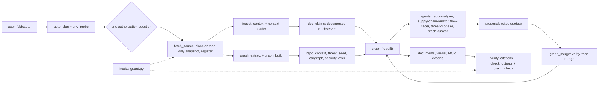

# Architecture

ckb is a Claude Code plugin made of **deterministic scripts** (Python standard library only) that read code and produce facts with citations, **agents** that add judgement on top of those facts, and **hooks** that keep the whole thing safe and honest. The scripts never execute anything from the analyzed repos; the agents are not trusted to produce uncited claims because the hooks and the verifier reject them.

## Layers

| Layer | Components | Role |
| --- | --- | --- |
| **Planning** | `env_probe.py`, `auto_plan.py`, `enumerate_sources.py` | decide sources, branches, parsers, stages, consent items from the environment and the code |
| **Acquisition** | `fetch_source.py`, `ckb_common.py` (target registry) | read-only access: clone with hooks off, git-archive snapshots, in-place reads; registers every target so hooks can protect it |
| **Extraction** | `inventory.py`, `graph_extract.py` (+ `graph_patterns.py`), `scan_supply_chain.py`, `ingest_context.py`, `pipeline_facts.py`, `deploy_facts.py`, `agent_graph.py` | turn files into candidates and facts, each with a citation: ASTs, regex patterns, scanner findings, converted documents |
| **Graph** | `graph_build.py`, `roles.py`, `graph_security.py`, `graph_merge.py`, `graph_common.py` | link cross-file and cross-repo references; attach findings and cloud resources; merge verified proposals; write `graph.json` + `graph.sqlite` |
| **Derivation** | `callgraph.py`, `coverage_report.py`, `threat_seed.py`, `doc_claims.py`, `repo_context.py`, `context_facts.py` | deterministic rule engines over the graph (extractor `rule`) |
| **Judgement** | agents + knowledge skills | read cited code, refine the draft threat model, write HLD/LLD, summaries and tours; add semantic edges only as verified proposals |
| **Access** | `graph_query.py` (GraphStore), `graph_mcp.py`, `graph_serve.py`, `graph_viewer.py`, `graph_export.py`, `graph_neo4j.py` | query, view, serve and export the graph (read-only) |
| **Assurance** | `verify_citations.py`, `check_outputs.py`, `graph_check.py`, `guard.py` (hooks), `citation-verifier` agent | nothing unverified or unsafe is written or trusted |

## Key design decisions

1. **Evidence or it didn't happen.** Every claim cites `repo/path:line`; quoted text is checked against the line. Anything inferred or unknown is labelled. The verifier runs as a script (always) and as an agent (a semantic sample).
2. **Static only.** No target code, build tool, package manager or hook is ever run. The guard hook blocks it; the scripts never import or execute targets.
3. **Facts first, then judgement.** Deterministic extractors build the graph before any agent runs, so agents navigate with cited starting points. Agents cannot edit the graph: they append *proposals* (a citation plus an exact quote), and `graph_merge.py` rejects any line whose citation or quote does not match the source.
4. **Honest provenance.** Each node/edge records how it was found (`ast` > `tree-sitter` > `regex` > `llm`/`rule`) and a confidence; rolled-up call graphs keep the *weakest* confidence along the way.
5. **Stable IDs.** `kind:repo:path:qualname` with no line numbers or code hashes, so a node keeps its identity when code moves, and summaries survive rebuilds (marked `[OUTDATED]` if the signature changed).
6. **Stdlib by default, optional extras.** Everything works with Python alone; tree-sitter, pdftotext, `az` and Neo4j are used only if the user already has them.
7. **Rules for the draft, agents for the rest.** The threat model, call graphs, documentation drift and repo context come from deterministic rules so that headless/CI runs still produce them; the threat-modeler agent then reviews them.
8. **Never trust target text.** Repo, document and image content is data; text aimed at AI agents is reported as a finding and never obeyed, never used in summaries, and neutralized in generated markdown.

## Data model

* **Targets** (`evidence/targets.json`, plus a per-user registry at `~/.ckb/targets.json` or `$CKB_HOME`): key → root path, revision, branch, source mode (`in-place`, `snapshot`, `clone`, `working-tree`), exclusions. Keys `ctx-*` are converted context.
* **Graph** (`graph/graph.json`): see the [schema](../skills/knowledge-graph/references/schema.md). Nodes and edges are produced by `graph_extract.py` (per-file fragments keyed by content hash, enabling incremental rebuilds), linked by `graph_build.py`, enriched by `graph_security.py`, and extended by merged proposals.
* **Proposals** (`graph/proposals/*.jsonl`): `{"op": "node"|"edge"|"annotate"|"tour", …}`; files named `seed-*.jsonl` come from deterministic generators and are merged with extractor `rule`, all others as `llm`.

## The graph build, in order

0. `lang_specs.py` supplies the per-language parsing rules (declarations, class spans, calls, imports, typed variables, inheritance) used by `graph_extract` for every language except Python.
1. `graph_extract` writes one fragment per source file (nodes, intra-file edges, unresolved references): functions and classes, entry points (endpoint, consumer, cron_job, cli_command), taint sources and sinks. Python uses `ast`; other languages use tree-sitter structure when installed and the patterns in `graph_patterns.py` otherwise. Test and generated files are skipped for entry points, sources and sinks.
2. `graph_build` links imports → class hierarchy (`inherits`, `implements`, `overrides`) → calls (typed receivers, MRO, interface dispatch, library calls, callbacks, accounting) → HTTP calls (client URL matched to endpoint path and method) → subprocess/binary; attaches IaC cloud resources, supply-chain findings, CSPM findings; merges verified proposals; carries summaries over; drops rule-drafted threats once a refined model and agent threats exist; writes JSON, SQLite, `system/graph.md` and the call graphs. Right after linking, `roles.py` assigns every file a role and every repo a kind (code map and file-roles evidence).
3. With `--enrich`: `repo_context` and `doc_claims` write seed proposals, `pipeline_facts` tabulates CI/CD pipelines, the graph is rebuilt, `threat_seed` writes the draft threat model and its proposals (including pipeline and IaC threats), the graph is rebuilt again, and `context_facts` writes the per-repo fact tables that are embedded in `context.md`.

## Extension points

New supply-chain checks, languages, context formats, threat rules, doc-claim checks, skills and agents: see the [developer guide](development.md).
