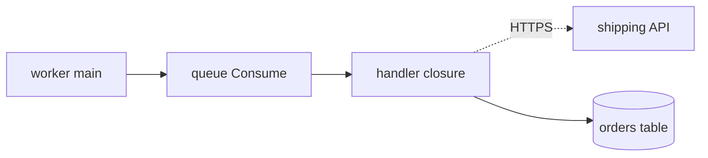

# fulfillment: call and data flows

> **ckb provenance**
> - Sources: `fulfillment` @ `d2ffc20`
> - Generated: 2026-11-24T05:26:33Z by ckb 0.1.0, stage `repo-analysis`
> - Scope: fulfillment · Excluded: vendored, generated, binaries, symlinks (none present)
> - Method: static analysis only; no target code executed
> - Verification: passed (15 citations, 0 errors; see evidence/verification.md)

## Inbound
| Entry point | Protocol | Handler chain | Source |
| --- | --- | --- | --- |
| queue `fulfillment.order-created` bound to `orders`/`order.created` | AMQP | `Consume` → handler closure in `main` | `fulfillment/internal/queue/consumer.go:26` `fulfillment/internal/queue/consumer.go:30` |
| pricing stdin | stdin JSON | `main` (pricing) | `fulfillment/cmd/pricing/main.go:18` |

## Outbound
| Call site | Target | Protocol | Payload or contract | Source | Confidence |
| --- | --- | --- | --- | --- | --- |
| worker handler | shipping API `SHIPPING_API_URL`/shipments | HTTPS (by deployment value) | order_id, address; bearer API key | `fulfillment/cmd/worker/main.go:28` | high |
| worker handler | Postgres `orders` table | SQL, parameterized | status update by order id | `fulfillment/cmd/worker/main.go:35` | high |

## Shared state
| Store | Access | Objects | Source |
| --- | --- | --- | --- |
| Postgres `orders` | w (UPDATE status) | status values `shipped` / `failed` | `fulfillment/cmd/worker/main.go:35` |

## Polyglot and boundary edges
| From | To | Mechanism | Other side | Source | Confidence |
| --- | --- | --- | --- | --- | --- |
| orders `price_items` | `cmd/pricing` | subprocess | `orders/app/pricing.py:10` | `fulfillment/cmd/pricing/main.go:14` | medium |

## Data models
| Model | Fields (sensitive marked) | Persistence | Source |
| --- | --- | --- | --- |
| OrderCreated | order_id, customer_id, total_cents, shipping_address (PII) | not stored here | `fulfillment/internal/queue/consumer.go:10` |

## Internal call graph (main paths)
[inferred] Summary of the cited rows above; labels are written by ckb.

## Observations
- Handler errors requeue the message (`Nack requeue=true`) with no retry limit or dead-letter path; malformed JSON is dropped with `requeue=false`. `fulfillment/internal/queue/consumer.go:46` «m.Nack(false, true)» `fulfillment/internal/queue/consumer.go:41` «m.Nack(false, false)»
- A shipping failure is recorded as `failed` and acknowledged, so it is never retried. `fulfillment/cmd/worker/main.go:32` `fulfillment/cmd/worker/main.go:36` [inferred]
- The shipping response body is never closed. `fulfillment/cmd/worker/main.go:30` [inferred]
- Pricing ignores the SKU and charges a flat 999 cents per unit; quantities are not range checked. `fulfillment/cmd/pricing/main.go:23` «total += it.Qty * 999»
