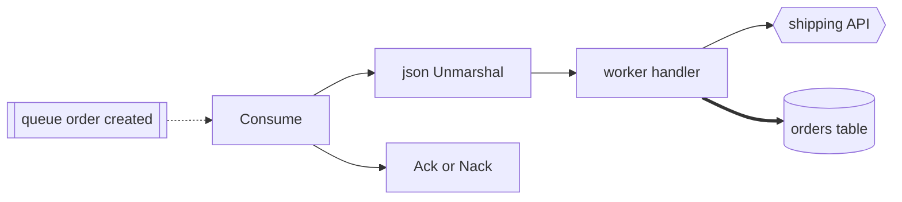

# fulfillment: call and data flows

> **ckb provenance**
> - Sources: `fulfillment` @ `unversioned (local)`, `platform` @ `unversioned (local)`, `orders` @ `unversioned (local)`
> - Generated: 2026-11-23T10:00:00Z by ckb 0.1.0, stage `analyze`
> - Scope: fulfillment (all files incl. go.sum) · Excluded: none
> - Method: static analysis only; no target code executed
> - Verification: passed (see evidence/verification.md)

## Inbound
| Entry point | Protocol | Handler chain | Source |
| --- | --- | --- | --- |
| queue `fulfillment.order-created` | AMQP (manual ack) | `Consume` → `json.Unmarshal` → worker handler → shipping POST → DB UPDATE → Ack/Nack | `fulfillment/internal/queue/consumer.go:33-49` |
| pricing stdin | subprocess | `main` decode → sum `qty*999` → encode | `fulfillment/cmd/pricing/main.go:18-25` |

## Outbound
| Call site | Target | Protocol | Payload or contract | Source | Confidence |
| --- | --- | --- | --- | --- | --- |
| worker handler | `${SHIPPING_API_URL}/shipments` (external shipping API) | HTTPS POST, bearer API key, 10s timeout | `{order_id, address}` | `fulfillment/cmd/worker/main.go:28` «http.NewRequest("POST", shippingURL+"/shipments", bytes.NewReader(payload))» `fulfillment/cmd/worker/main.go:29` | high |
| worker handler | Postgres table `orders` | SQL UPDATE (parameterized) | status, id | `fulfillment/cmd/worker/main.go:35` «db.Exec("UPDATE orders SET status = $1 WHERE id = $2", status, evt.OrderID)» | high |
| pricing | stdout | JSON | `{total_cents}` | `fulfillment/cmd/pricing/main.go:25` | high |

## Shared state
| Store | Access | Objects | Source |
| --- | --- | --- | --- |
| Postgres `shop` | w | `orders.status` | `fulfillment/cmd/worker/main.go:18` «sql.Open("postgres", os.Getenv("DATABASE_URL"))» `fulfillment/cmd/worker/main.go:35` |
| RabbitMQ | r | queue `fulfillment.order-created` | `fulfillment/internal/queue/consumer.go:26` |

## Internal call graph (main paths)

From `fulfillment/internal/queue/consumer.go:37-49` and `fulfillment/cmd/worker/main.go:26-37`.
