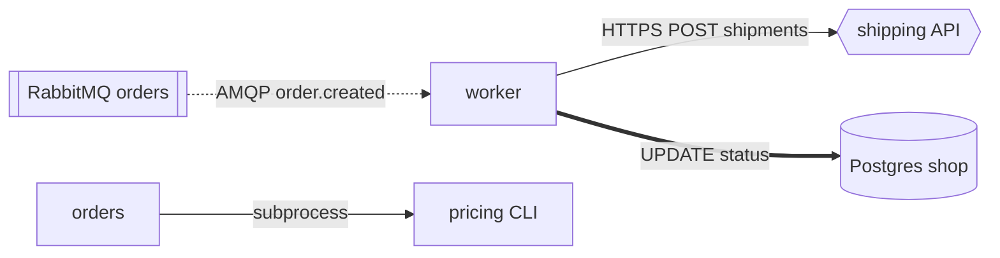
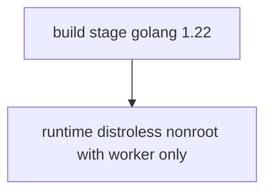

# fulfillment: high-level design

> **ckb provenance**
> - Sources: `fulfillment` @ `unversioned (local)`, `platform` @ `unversioned (local)`, `orders` @ `unversioned (local)`
> - Generated: 2026-11-23T10:00:00Z by ckb 0.1.0, stage `analyze`
> - Scope: fulfillment (all files) · Excluded: none
> - Method: static analysis only; no target code executed
> - Verification: passed (see evidence/verification.md)

## Components and responsibilities
| Component | Responsibility | Tech | Source |
| --- | --- | --- | --- |
| worker (`cmd/worker`) | Ship orders on `order.created` and record status | Go, net/http, database/sql | `fulfillment/cmd/worker/main.go:17-41` |
| queue consumer (`internal/queue`) | Declare/bind queue, decode, ack/nack | amqp091-go | `fulfillment/internal/queue/consumer.go:17-52` |
| pricing CLI (`cmd/pricing`) | Compute total cents from items | Go stdlib | `fulfillment/cmd/pricing/main.go:14-26` |

## Boundaries and external dependencies
| Boundary or external system | Direction | Protocol | Source |
| --- | --- | --- | --- |
| RabbitMQ exchange `orders` | inbound | AMQP | `fulfillment/internal/queue/consumer.go:30` |
| External shipping API | outbound | HTTPS, bearer key | `platform/deploy/docker-compose.yml:18` «SHIPPING_API_URL: https://api.shipping.example.com» `fulfillment/cmd/worker/main.go:29` «req.Header.Set("Authorization", "Bearer "+apiKey)» |
| Postgres `shop` | outbound | SQL | `fulfillment/cmd/worker/main.go:35` |
| orders service (pricing caller) | inbound | subprocess | `orders/app/pricing.py:10` |

## Component diagram

Edges: `fulfillment/internal/queue/consumer.go:30` `fulfillment/cmd/worker/main.go:28` `fulfillment/cmd/worker/main.go:35` `orders/app/pricing.py:10`.

## Deployment topology

From `fulfillment/Dockerfile:1-9`. No K8s manifest for fulfillment `[unknown]`.

## Key design decisions and constraints
| Decision or constraint | Evidence | Label | Confidence |
| --- | --- | --- | --- |
| Durable queue, manual ack | `fulfillment/internal/queue/consumer.go:26` `fulfillment/internal/queue/consumer.go:33` «ch.Consume(q.Name, "fulfillment", false, false, false, false, nil)» | observed | high |
| Bad JSON dropped (Nack, no requeue), no DLQ declared | `fulfillment/internal/queue/consumer.go:41` «m.Nack(false, false)» | observed | high |
| Handler error requeued indefinitely | `fulfillment/internal/queue/consumer.go:46` «m.Nack(false, true)» | observed | high |
| Shipping failure marks order `failed`, no retry | `fulfillment/cmd/worker/main.go:31-34` | observed | high |
| HTTP client timeout 10s | `fulfillment/cmd/worker/main.go:24` «client := &http.Client{Timeout: 10 * time.Second}» | observed | high |
