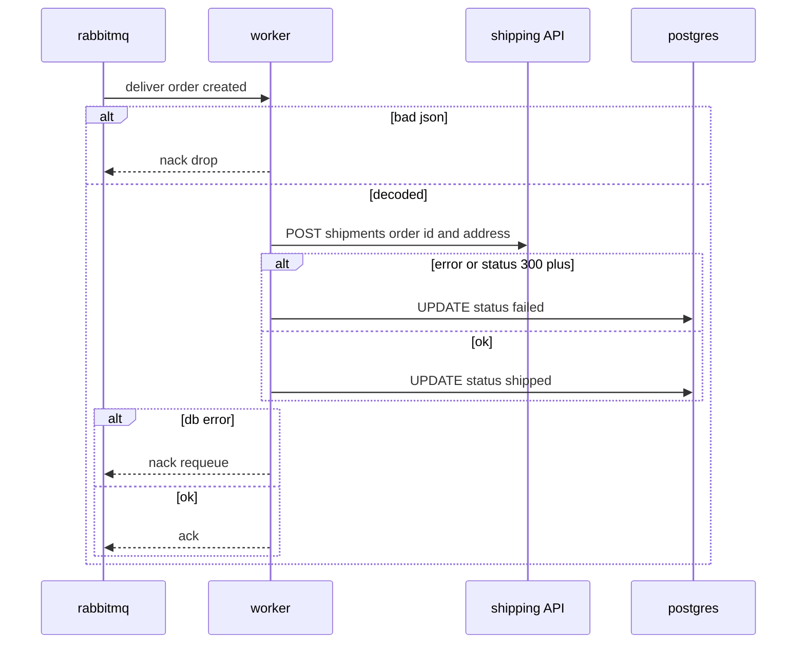
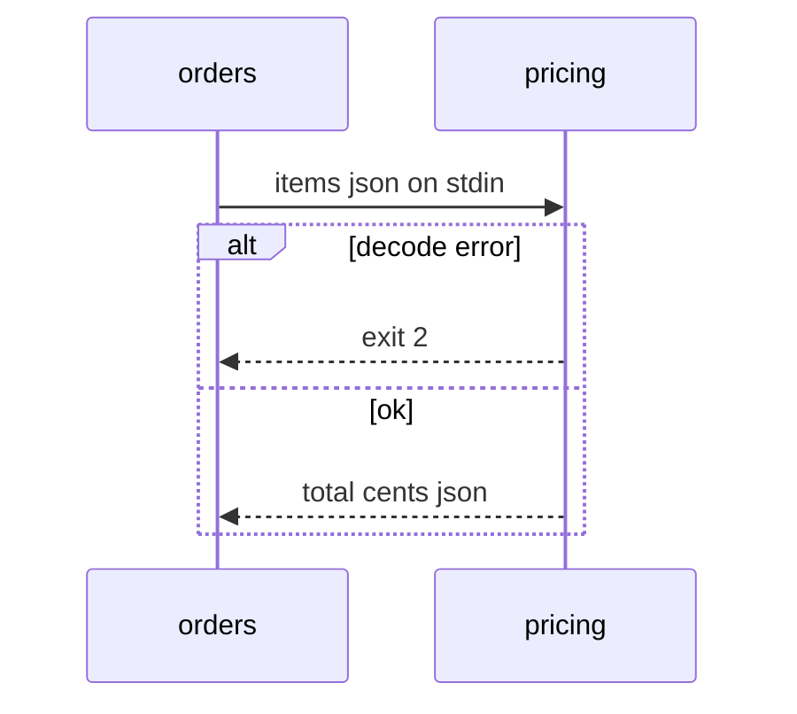

# fulfillment: low-level design

> **ckb provenance**
> - Sources: `fulfillment` @ `unversioned (local)`, `platform` @ `unversioned (local)`, `orders` @ `unversioned (local)`
> - Generated: 2026-11-23T10:00:00Z by ckb 0.1.0, stage `analyze`
> - Scope: fulfillment (all files) · Excluded: none
> - Method: static analysis only; no target code executed
> - Verification: passed (see evidence/verification.md)

## Modules
| Module or package | Responsibility | Key types/functions | Source |
| --- | --- | --- | --- |
| cmd/worker | wiring and shipping logic | `main` | `fulfillment/cmd/worker/main.go:17` |
| internal/queue | AMQP consume loop | `OrderCreated`, `Consume` | `fulfillment/internal/queue/consumer.go:10-17` |
| cmd/pricing | pricing CLI | `item`, `main` | `fulfillment/cmd/pricing/main.go:9-14` |

## Main flows
### Flow: ship order on order.created

Steps (each cited):
1. Queue declared durable and bound to `orders` / `order.created`. `fulfillment/internal/queue/consumer.go:26-30`
2. Decode into `OrderCreated`; bad JSON is Nacked without requeue. `fulfillment/internal/queue/consumer.go:38-42`
3. Build `{order_id, address}` and POST with bearer key; marshal and request errors are ignored. `fulfillment/cmd/worker/main.go:27-30`
4. Status `failed` on transport error or status >= 300, else `shipped`. `fulfillment/cmd/worker/main.go:31-34`
5. Parameterized UPDATE; its error decides Ack vs requeue. `fulfillment/cmd/worker/main.go:35-36` `fulfillment/internal/queue/consumer.go:44-49`

### Flow: pricing CLI

Steps:
1. Decode stdin into `[]item`; exit 2 on error. `fulfillment/cmd/pricing/main.go:17-20`
2. Sum `Qty * 999` with no bound on negative quantities. `fulfillment/cmd/pricing/main.go:22-24`

## Data models
| Model or table | Fields (sensitive marked) | Persistence | Source |
| --- | --- | --- | --- |
| `OrderCreated` | OrderID, CustomerID (identity), TotalCents, ShippingAddress (PII) | message | `fulfillment/internal/queue/consumer.go:10-15` |
| shipping payload | order_id, address (PII) | sent to third party | `fulfillment/cmd/worker/main.go:27` |
| `orders.status` | shipped / failed | Postgres | `fulfillment/cmd/worker/main.go:35` |

## Error handling
| Where | Error | Handling | User-visible effect | Source |
| --- | --- | --- | --- | --- |
| startup | DB open error | log.Fatal | worker exits | `fulfillment/cmd/worker/main.go:19-21` |
| consume | bad JSON | Nack, no requeue, no DLQ | message lost | `fulfillment/internal/queue/consumer.go:39-42` |
| handler | DB update error | Nack with requeue | redelivery loop on persistent error [inferred] | `fulfillment/internal/queue/consumer.go:44-47` |
| shipping | transport or non-2xx | status `failed` | order shows failed | `fulfillment/cmd/worker/main.go:32-34` |
| shipping | `http.NewRequest` error ignored | nil request deref | panic, worker exits [inferred] | `fulfillment/cmd/worker/main.go:28` |
| shipping | response body not closed | none | connection leak [inferred] | `fulfillment/cmd/worker/main.go:30` |

## Polyglot and boundary edges
| From | To | Mechanism | Source |
| --- | --- | --- | --- |
| orders (Python) | pricing (Go) | subprocess JSON stdin/stdout | `orders/app/pricing.py:10` `fulfillment/cmd/pricing/main.go:25` |
