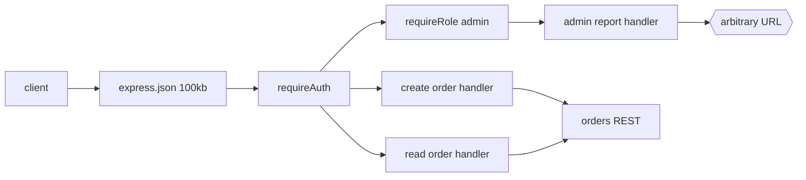

# gateway: call and data flows

> **ckb provenance**
> - Sources: `gateway` @ `unversioned (local ./polyglot/gateway)`, `platform` @ `unversioned (local ./polyglot)`
> - Generated: 2026-11-23T10:00:00Z by ckb 0.1.0, stage `analyze`
> - Scope: gateway/src, package.json, package-lock.json, Dockerfile; platform/deploy, platform/contracts for context · Excluded: none (no secrets files, binaries or symlinks found)
> - Method: static analysis only; no target code executed
> - Verification: passed (see evidence/verification.md)

## Inbound
| Entry point | Protocol | Handler chain | Source |
| --- | --- | --- | --- |
| POST /orders | HTTPS (JSON, 100kb limit) | express.json → requireAuth → handler → axios.post | `gateway/src/server.js:9` «app.use(express.json({ limit: '100kb' }));» `gateway/src/server.js:13-19` |
| GET /orders/:id | HTTPS | requireAuth → handler → axios.get | `gateway/src/server.js:26-28` |
| GET /admin/report | HTTPS | requireAuth → requireRole('admin') → axios.get(query.source) | `gateway/src/server.js:31-33` |
| GET /healthz | HTTPS | inline | `gateway/src/server.js:11` |

## Outbound
| Call site | Target | Protocol | Payload or contract | Source | Confidence |
| --- | --- | --- | --- | --- | --- |
| create order | orders `POST ${ORDERS_URL}/orders` | REST | request body spread plus `customer_id` from JWT `sub`; header `x-request-user` | `gateway/src/server.js:15` «axios.post(`${ORDERS_URL}/orders`, { ...req.body, customer_id: req.user.sub }» `gateway/src/server.js:17` «'x-request-user': req.user.sub» | high |
| read order | orders `GET ${ORDERS_URL}/orders/${id}` | REST | path param unencoded | `gateway/src/server.js:27` «axios.get(`${ORDERS_URL}/orders/${req.params.id}`» | high |
| admin report | any URL from `?source=` | HTTP(S) | none | `gateway/src/server.js:32` «axios.get(`${req.query.source}`» | high |

## Shared state
| Store | Access | Objects | Source |
| --- | --- | --- | --- |
| none | n/a | [n/a] gateway holds no datastore client | `gateway/package.json:6-10` |

## Internal call graph (main paths)

Derived from the route and middleware registrations in `gateway/src/server.js:9-33`.
