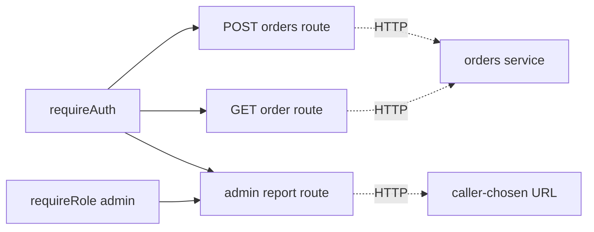

# gateway: call and data flows

> **ckb provenance**
> - Sources: `gateway` @ `8c8444d`
> - Generated: 2026-11-24T05:26:33Z by ckb 0.1.0, stage `repo-analysis`
> - Scope: gateway · Excluded: vendored, generated, binaries, symlinks (none present)
> - Method: static analysis only; no target code executed
> - Verification: passed (14 citations, 0 errors; see evidence/verification.md)

## Inbound
| Entry point | Protocol | Handler chain | Source |
| --- | --- | --- | --- |
| GET /healthz | HTTP | inline | `gateway/src/server.js:11` |
| POST /orders | HTTP | `requireAuth` → inline | `gateway/src/server.js:13` |
| GET /orders/:id | HTTP | `requireAuth` → inline | `gateway/src/server.js:26` |
| GET /admin/report | HTTP | `requireAuth` → `requireRole` → inline | `gateway/src/server.js:31` |

## Outbound
| Call site | Target | Protocol | Payload or contract | Source | Confidence |
| --- | --- | --- | --- | --- | --- |
| POST /orders handler | orders POST /orders | HTTP (default `http://orders:8000`) | body plus `customer_id` from the JWT subject, header `x-request-user` | `gateway/src/server.js:15` | high |
| GET /orders/:id handler | orders GET /orders/{order_id} | HTTP | id interpolated into the URL path | `gateway/src/server.js:27` | high |
| GET /admin/report handler | any URL in query `source` | HTTP GET | response body returned to caller | `gateway/src/server.js:32` «axios.get(`${req.query.source}`» | high |

## Shared state
[n/a] the gateway holds no store.

## Polyglot and boundary edges
[n/a] none.

## Data models
[n/a] no models; JWT payload fields `sub` and `role` are used. `gateway/src/auth.js:26`

## Internal call graph (main paths)
[inferred] Summary of the cited rows above; labels are written by ckb.

## Observations
- Auth bypass switch: when `AUTH_DISABLED` is `true`, every caller becomes `{sub:'dev', role:'admin'}`. `gateway/src/auth.js:7` «if (AUTH_DISABLED) {» `gateway/src/auth.js:8` «req.user = { sub: 'dev', role: 'admin' };»
- The POST route wraps the upstream call in try/catch, but GET /orders/:id and GET /admin/report do not; with Express 4 an async rejection is unhandled. `gateway/src/server.js:20` `gateway/src/server.js:26` `gateway/src/server.js:31` [inferred]
- GET /orders/:id performs no ownership check against `req.user`. `gateway/src/server.js:27`
