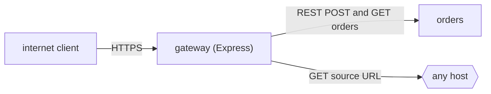
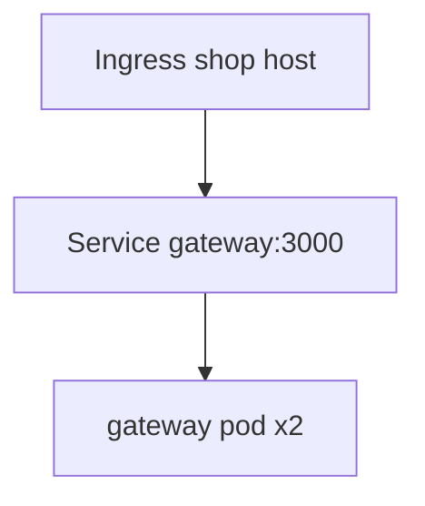

# gateway: high-level design

> **ckb provenance**
> - Sources: `gateway` @ `unversioned (local)`, `platform` @ `unversioned (local)`
> - Generated: 2026-11-23T10:00:00Z by ckb 0.1.0, stage `analyze`
> - Scope: gateway (all files); platform deploy files for context · Excluded: none
> - Method: static analysis only; no target code executed
> - Verification: passed (see evidence/verification.md)

## Components and responsibilities
| Component | Responsibility | Tech | Source |
| --- | --- | --- | --- |
| HTTP server | Public API, JSON body parsing (100kb), routing | Express 4.19.2 | `gateway/src/server.js:8-9` |
| Auth middleware | Bearer JWT (HS256) verification, role check, dev bypass toggle | jsonwebtoken 9.0.2 | `gateway/src/auth.js:6-31` |
| Orders proxy | Forwards create/read order calls to orders | axios 1.7.2 | `gateway/src/server.js:15` `gateway/src/server.js:27` |
| Admin report proxy | Fetches a caller-supplied URL and returns the body | axios | `gateway/src/server.js:32` «axios.get(`${req.query.source}`» |

## Boundaries and external dependencies
| Boundary or external system | Direction | Protocol | Source |
| --- | --- | --- | --- |
| Internet clients via Ingress `shop.example.com` | inbound | HTTP(S) | `platform/deploy/k8s/gateway.yaml:27` «- host: shop.example.com» |
| orders service | outbound | REST, 5s timeout | `gateway/src/server.js:16` «timeout: 5000,» |
| Arbitrary hosts (admin report) | outbound | HTTP(S) | `gateway/src/server.js:32` |

## Component diagram

Edges: `gateway/src/server.js:15` `gateway/src/server.js:27` `gateway/src/server.js:32`.

## Deployment topology

From `platform/deploy/k8s/gateway.yaml:6` «replicas: 2» and `platform/deploy/k8s/gateway.yaml:33` «service: { name: gateway, port: { number: 3000 } }». No K8s Service object is in scope `[unknown]`.

## Key design decisions and constraints
| Decision or constraint | Evidence | Label | Confidence |
| --- | --- | --- | --- |
| JSON body limit 100kb | `gateway/src/server.js:9` «limit: '100kb'» | observed | high |
| Upstream timeout 5s | `gateway/src/server.js:16` «timeout: 5000,» | observed | high |
| JWT algorithm pinned to HS256 | `gateway/src/auth.js:17` «algorithms: ['HS256']» | observed | high |
| Auth can be disabled by env and then grants admin | `gateway/src/auth.js:4` «const AUTH_DISABLED = process.env.AUTH_DISABLED === 'true';» `gateway/src/auth.js:8` «req.user = { sub: 'dev', role: 'admin' };» | observed | high |
| Container non-root, lifecycle scripts disabled | `gateway/Dockerfile:4` «--ignore-scripts» `gateway/Dockerfile:6` «USER node» | observed | high |
