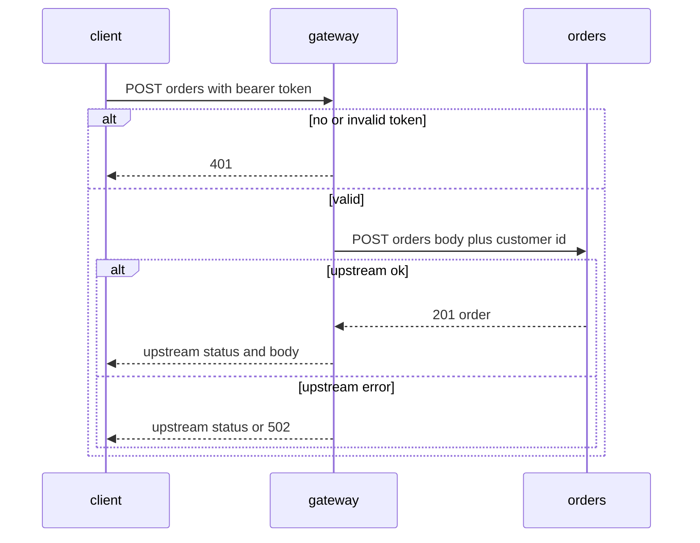
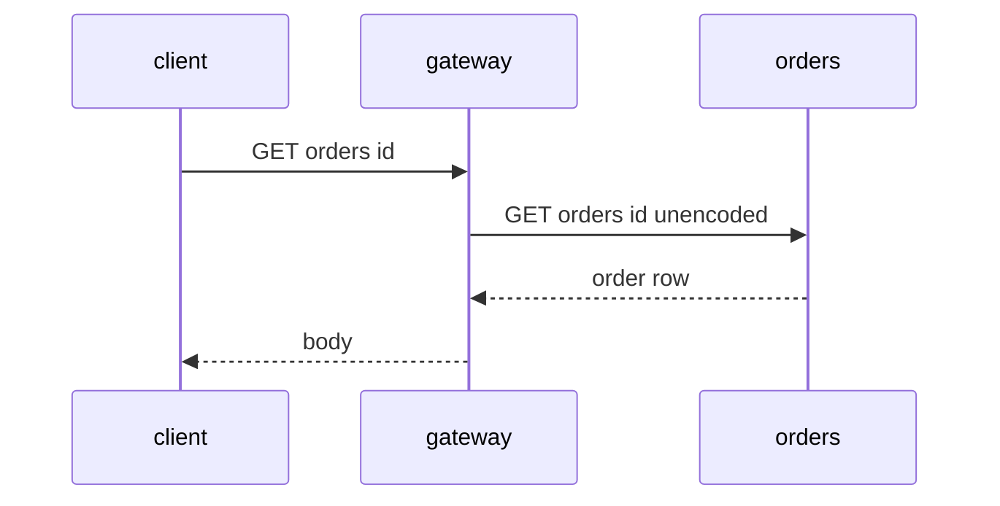
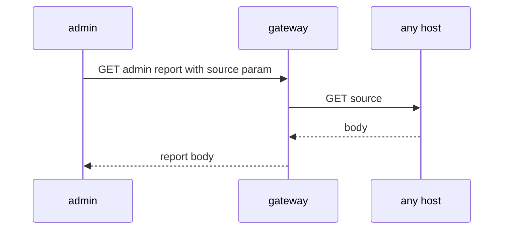

# gateway: low-level design

> **ckb provenance**
> - Sources: `gateway` @ `unversioned (local)`, `platform` @ `unversioned (local)`
> - Generated: 2026-11-23T10:00:00Z by ckb 0.1.0, stage `analyze`
> - Scope: gateway (all files); platform deploy files for context · Excluded: none
> - Method: static analysis only; no target code executed
> - Verification: passed (see evidence/verification.md)

## Modules
| Module or package | Responsibility | Key types/functions | Source |
| --- | --- | --- | --- |
| src/server.js | App setup, routes, upstream calls | `app.post('/orders')`, `app.get('/orders/:id')`, `app.get('/admin/report')` | `gateway/src/server.js:8-36` |
| src/auth.js | JWT verification and role gate | `requireAuth`, `requireRole` | `gateway/src/auth.js:6` «function requireAuth(req, res, next) {» `gateway/src/auth.js:24` «function requireRole(role) {» |

## Main flows
### Flow: create order

Steps (each cited):
1. Body parsed with a 100kb limit. `gateway/src/server.js:9`
2. `requireAuth` reads `Authorization: Bearer`, returns 401 if missing. `gateway/src/auth.js:11-15`
3. Token verified with `JWT_SECRET`, HS256 only; failure returns 401. `gateway/src/auth.js:17-21`
4. Body forwarded with `customer_id` overwritten by the token `sub`. `gateway/src/server.js:15`
5. Upstream status and body relayed; on error, upstream status or 502 with a generic message. `gateway/src/server.js:19-22`

### Flow: read order

Steps:
1. `requireAuth` only; no ownership check against `req.user.sub`. `gateway/src/server.js:26`
2. The raw `req.params.id` is interpolated into the upstream path. `gateway/src/server.js:27`
3. No try/catch: an upstream error rejects the async handler, which Express 4 does not catch `[inferred]` from `gateway/src/server.js:26-29` and `gateway/package.json:7`.

### Flow: admin report

Steps:
1. `requireRole('admin')` compares `req.user.role`. `gateway/src/auth.js:26` «if (!req.user || req.user.role !== role) {»
2. `req.query.source` fetched without allowlist (SSRF). `gateway/src/server.js:32`

## Data models
| Model or table | Fields (sensitive marked) | Persistence | Source |
| --- | --- | --- | --- |
| JWT claims `req.user` | `sub` (identity), `role` (authz) | none (request scope) | `gateway/src/auth.js:17` |
| Forwarded order body | client-supplied fields plus `customer_id` | none | `gateway/src/server.js:15` |

## Error handling
| Where | Error | Handling | User-visible effect | Source |
| --- | --- | --- | --- | --- |
| requireAuth | missing token | return | 401 `missing token` | `gateway/src/auth.js:13-15` |
| requireAuth | verify failure | catch | 401 `invalid token` | `gateway/src/auth.js:19-21` |
| requireRole | role mismatch | return | 403 `forbidden` | `gateway/src/auth.js:26-28` |
| POST /orders | upstream error | catch | upstream status or 502 | `gateway/src/server.js:20-22` |
| GET /orders/:id, /admin/report | upstream error | none (unhandled rejection) | request likely hangs `[inferred]` | `gateway/src/server.js:26-34` |

## Polyglot and boundary edges
| From | To | Mechanism | Source |
| --- | --- | --- | --- |
| gateway (Node) | orders (Python) | REST over HTTP, generated client: none | `gateway/src/server.js:15` |
