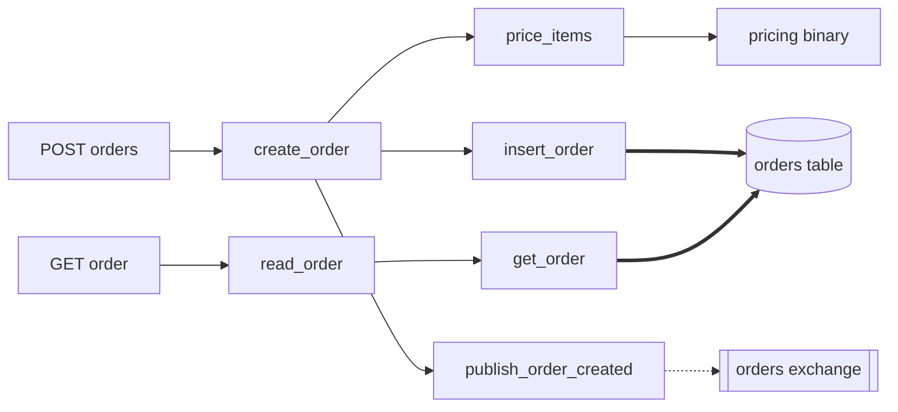

# orders: call and data flows

> **ckb provenance**
> - Sources: `orders` @ `unversioned (local)`, `platform` @ `unversioned (local)`
> - Generated: 2026-11-23T10:00:00Z by ckb 0.1.0, stage `analyze`
> - Scope: orders (all files); platform deploy and contracts for context · Excluded: none
> - Method: static analysis only; no target code executed
> - Verification: passed (see evidence/verification.md)

## Inbound
| Entry point | Protocol | Handler chain | Source |
| --- | --- | --- | --- |
| POST /orders | HTTP JSON | `create_order` → `pricing.price_items` → `db.insert_order` → `events.publish_order_created` | `orders/app/main.py:26-34` |
| GET /orders/{order_id} | HTTP | `read_order` → `db.get_order` | `orders/app/main.py:38-42` |

## Outbound
| Call site | Target | Protocol | Payload or contract | Source | Confidence |
| --- | --- | --- | --- | --- | --- |
| `price_items` | `pricing` binary (`PRICING_BIN`) | subprocess stdin/stdout JSON | items list → `{total_cents}` | `orders/app/pricing.py:10` «subprocess.run([PRICING_BIN, "--json"], input=json.dumps(items)» | high |
| `insert_order` | Postgres table `orders` | SQL INSERT (parameterized) | id, customer_id, total_cents, card_last4, status | `orders/app/db.py:15` «"INSERT INTO orders (id, customer_id, total_cents, card_last4, status) VALUES (%s, %s, %s, %s, 'pending')"» | high |
| `get_order` | Postgres table `orders` | SQL SELECT (string-built) | id | `orders/app/db.py:23` «cur.execute(f"SELECT id, status, total_cents FROM orders WHERE id = '{order_id}'")» | high |
| `publish_order_created` | RabbitMQ exchange `orders`, key `order.created` | AMQP topic | order_id, customer_id, total_cents, shipping_address | `orders/app/events.py:7` «EXCHANGE = "orders"» `orders/app/events.py:24` «ch.basic_publish(exchange=EXCHANGE, routing_key=ROUTING_KEY, body=body)» | high |

## Shared state
| Store | Access | Objects | Source |
| --- | --- | --- | --- |
| Postgres `shop` | r/w | table `orders` | `orders/app/db.py:5` «DATABASE_URL = os.environ.get("DATABASE_URL", "postgresql://orders@db:5432/shop")» |

## Internal call graph (main paths)

From `orders/app/main.py:29-33` and `orders/app/main.py:39`.
