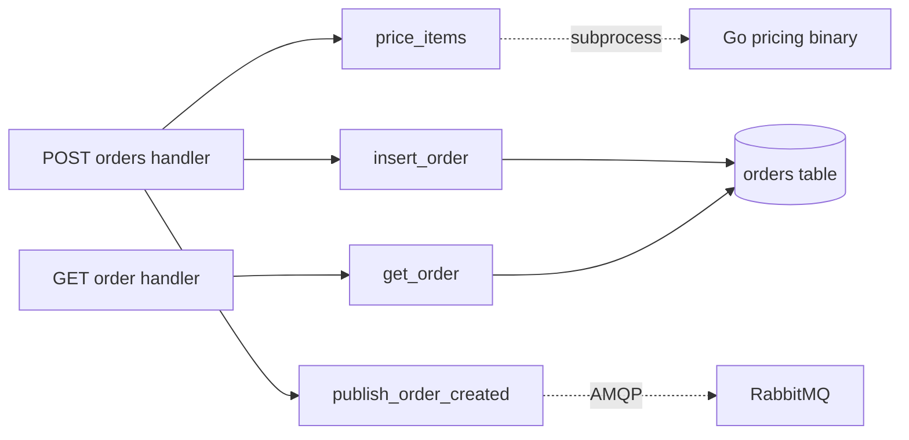

# orders: call and data flows

> **ckb provenance**
> - Sources: `orders` @ `1de64cb` (snapshot of `main`)
> - Generated: 2026-11-24T05:25:46Z by ckb 0.1.0, stage `repo-analysis`
> - Scope: orders main snapshot · Excluded: vendored, generated, binaries, symlinks (none present)
> - Method: static analysis only; no target code executed
> - Verification: passed (20 citations, 0 errors; see evidence/verification.md)

## Inbound
| Entry point | Protocol | Handler chain | Source |
| --- | --- | --- | --- |
| POST /orders | HTTP (from gateway) | `create_order` → `price_items` → `get_conn` → `insert_order` → `publish_order_created` | `orders/app/main.py:29` `orders/app/main.py:32` `orders/app/main.py:33` |
| GET /orders/{order_id} | HTTP (from gateway) | `read_order` → `get_conn` → `get_order` | `orders/app/main.py:39` |

## Outbound
| Call site | Target | Protocol | Payload or contract | Source | Confidence |
| --- | --- | --- | --- | --- | --- |
| `price_items` | local Go `pricing` binary | subprocess, stdin/stdout JSON | list of sku/qty, returns `total_cents` | `orders/app/pricing.py:10` | high |
| `publish_order_created` | RabbitMQ exchange `orders`, key `order.created` | AMQP (plain by default) | order_id, customer_id, total_cents, shipping_address | `orders/app/events.py:24` | high |
| `insert_order` | Postgres table `orders` | SQL, parameterized | id, customer_id, total_cents, card_last4, status | `orders/app/db.py:14` | high |
| `get_order` | Postgres table `orders` | SQL, string-built | id, status, total_cents | `orders/app/db.py:23` | high |

## Shared state
| Store | Access | Objects | Source |
| --- | --- | --- | --- |
| Postgres `orders` table | r/w (fulfillment also writes status) | order rows incl. `card_last4` | `orders/app/db.py:15` `orders/app/db.py:23` |

## Polyglot and boundary edges
| From | To | Mechanism | Other side | Source | Confidence |
| --- | --- | --- | --- | --- | --- |
| `orders/app/pricing.py` | Go pricing binary | subprocess, argv list, no shell | `fulfillment/cmd/pricing/main.go:14` | `orders/app/pricing.py:10` | high |

## Data models
| Model | Fields (sensitive marked) | Persistence | Source |
| --- | --- | --- | --- |
| OrderRequest | customer_id, items, card_last4 (sensitive, last 4 digits only), shipping_address (PII) | table `orders` (address is only published, not stored) | `orders/app/main.py:18` |
| Item | sku, qty (no lower bound) | none | `orders/app/main.py:13` |

## Internal call graph (main paths)
[inferred] Summary of the cited rows above; labels are written by ckb.

## Observations
- `get_order` interpolates the id into SQL with an f-string, while `insert_order` is parameterized. `orders/app/db.py:23` «cur.execute(f"SELECT id, status, total_cents FROM orders WHERE id = '{order_id}'")» `orders/app/db.py:15` «VALUES (%s, %s, %s, %s, 'pending')»
- If `PUBLISH_EVENTS` is not `true`, publishing is skipped silently and the order stays `pending`. `orders/app/events.py:13` «if not PUBLISH_EVENTS:»
- The order is committed before publish, with no outbox; a publish failure returns an error after the row exists. `orders/app/main.py:32` `orders/app/main.py:33` [inferred]
- Connections from `get_conn` are never closed. `orders/app/main.py:31` [inferred]
