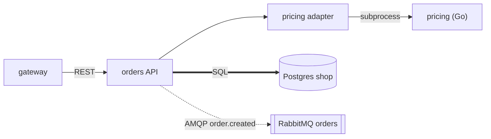
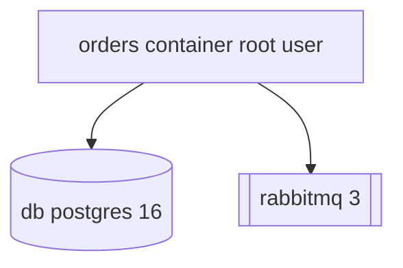

# orders: high-level design

> **ckb provenance**
> - Sources: `orders` @ `unversioned (local)`, `platform` @ `unversioned (local)`, `fulfillment` @ `unversioned (local)`
> - Generated: 2026-11-23T10:00:00Z by ckb 0.1.0, stage `analyze`
> - Scope: orders (all files) · Excluded: none
> - Method: static analysis only; no target code executed
> - Verification: passed (see evidence/verification.md)

## Components and responsibilities
| Component | Responsibility | Tech | Source |
| --- | --- | --- | --- |
| API (`app/main.py`) | Validate and create orders, read orders | FastAPI + pydantic | `orders/app/main.py:9-42` |
| Persistence (`app/db.py`) | Connect to Postgres and read/write `orders` | psycopg2 | `orders/app/db.py:8-24` |
| Events (`app/events.py`) | Publish `order.created` | pika | `orders/app/events.py:12-26` |
| Pricing adapter (`app/pricing.py`) | Run the Go pricing binary | subprocess | `orders/app/pricing.py:8-13` |

## Boundaries and external dependencies
| Boundary or external system | Direction | Protocol | Source |
| --- | --- | --- | --- |
| gateway (caller) | inbound | REST | `platform/deploy/docker-compose.yml:6` «ORDERS_URL: http://orders:8000» |
| Postgres `shop` | outbound | SQL | `orders/app/db.py:9` «return psycopg2.connect(DATABASE_URL)» |
| RabbitMQ | outbound | AMQP | `orders/app/events.py:15` «conn = pika.BlockingConnection(pika.URLParameters(RABBITMQ_URL))» |
| pricing binary (built from `fulfillment/cmd/pricing`) | local process | subprocess | `orders/app/pricing.py:9` «Calls the Go pricing binary (fulfillment/cmd/pricing) over stdin/stdout.» |

## Component diagram

Edges: `orders/app/pricing.py:10` `orders/app/db.py:9` `orders/app/events.py:24`.

## Deployment topology

From `platform/deploy/docker-compose.yml:8-12` and `orders/Dockerfile:6`. No K8s manifest for orders `[unknown]`.

## Key design decisions and constraints
| Decision or constraint | Evidence | Label | Confidence |
| --- | --- | --- | --- |
| Max items per order (env, default 50) | `orders/app/main.py:10` «MAX_ITEMS = int(os.environ.get("MAX_ITEMS", "50"))» | observed | high |
| Pricing subprocess timeout 5s | `orders/app/pricing.py:10` «timeout=5» | observed | high |
| Event publishing toggle (default on) | `orders/app/events.py:9` «PUBLISH_EVENTS = os.environ.get("PUBLISH_EVENTS", "true") == "true"» | observed | high |
| DB commit happens before publish; no outbox | `orders/app/main.py:32-33` | [inferred] dual-write without transaction | medium |
| No authentication on orders routes | `orders/app/main.py:25-38` | observed | high |
