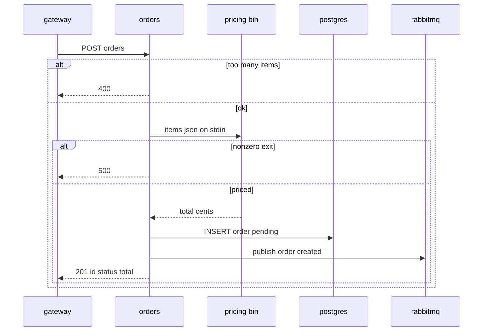
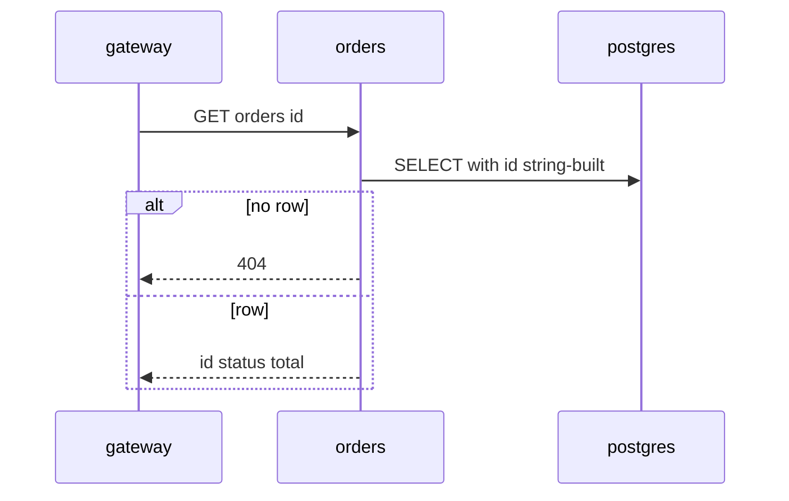

# orders: low-level design

> **ckb provenance**
> - Sources: `orders` @ `unversioned (local)`, `platform` @ `unversioned (local)`, `fulfillment` @ `unversioned (local)`
> - Generated: 2026-11-23T10:00:00Z by ckb 0.1.0, stage `analyze`
> - Scope: orders (all files) · Excluded: none
> - Method: static analysis only; no target code executed
> - Verification: passed (see evidence/verification.md)

## Modules
| Module or package | Responsibility | Key types/functions | Source |
| --- | --- | --- | --- |
| app/main.py | routes and request models | `Item`, `OrderRequest`, `create_order`, `read_order` | `orders/app/main.py:13-42` |
| app/db.py | DB access | `get_conn`, `insert_order`, `get_order` | `orders/app/db.py:8-24` |
| app/events.py | AMQP publish | `publish_order_created` | `orders/app/events.py:12` |
| app/pricing.py | subprocess pricing | `price_items` | `orders/app/pricing.py:8` |

## Main flows
### Flow: create order

Steps (each cited):
1. Body validated by pydantic `OrderRequest`; `qty` is any int (no lower bound). `orders/app/main.py:13-22`
2. Reject when items exceed `MAX_ITEMS`. `orders/app/main.py:27-28`
3. Price via subprocess; non-zero exit raises `RuntimeError`. `orders/app/pricing.py:10-13`
4. Insert with parameters and commit. `orders/app/db.py:14-18`
5. Publish `order.created` unless disabled. `orders/app/events.py:13-24`
6. Return `{id, status: pending, total_cents}`. `orders/app/main.py:34`

### Flow: read order

Steps:
1. `order_id` path parameter passed straight to `get_order`. `orders/app/main.py:38-39`
2. SQL built with an f-string (SQL injection). `orders/app/db.py:23`
3. 404 when no row. `orders/app/main.py:40-41`

## Data models
| Model or table | Fields (sensitive marked) | Persistence | Source |
| --- | --- | --- | --- |
| `OrderRequest` | customer_id (identity), items, card_last4 (payment, partial PAN), shipping_address (PII) | request | `orders/app/main.py:18-22` |
| `orders` table | id, customer_id, total_cents, card_last4 (payment), status | Postgres | `orders/app/db.py:15` |
| `order.created` event | order_id, customer_id, total_cents, shipping_address (PII) | RabbitMQ | `orders/app/events.py:18-23` |

## Error handling
| Where | Error | Handling | User-visible effect | Source |
| --- | --- | --- | --- | --- |
| create_order | too many items | HTTPException | 400 `too many items` | `orders/app/main.py:28` |
| price_items | non-zero exit | raise RuntimeError | 500 [inferred] FastAPI default | `orders/app/pricing.py:11-12` |
| price_items | binary missing or timeout | uncaught exception | 500 [inferred] | `orders/app/pricing.py:10` |
| publish_order_created | broker down | uncaught after DB commit | 500 but order row persisted with no event [inferred] | `orders/app/main.py:32-33` |
| read_order | no row | HTTPException | 404 | `orders/app/main.py:40-41` |

## Polyglot and boundary edges
| From | To | Mechanism | Source |
| --- | --- | --- | --- |
| orders (Python) | pricing (Go, `fulfillment/cmd/pricing`) | subprocess, JSON stdin/stdout | `orders/app/pricing.py:10` `fulfillment/cmd/pricing/main.go:18` «json.NewDecoder(os.Stdin).Decode(&items)» |
