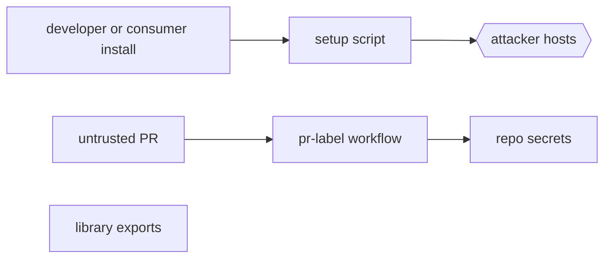

# poisoned: high-level design

> **ckb provenance**
> - Sources: `poisoned` @ `unversioned (local ./poisoned)`
> - Generated: 2026-11-23T10:00:00Z by ckb 0.1.0, stage `analyze`
> - Scope: poisoned (all files) · Excluded: none
> - Method: static analysis only; no target code executed
> - Verification: passed (see evidence/verification.md)

## Components and responsibilities
| Component | Responsibility | Tech | Source |
| --- | --- | --- | --- |
| library `src/index.js` | string padding and an admin check | Node.js | `poisoned/src/index.js:3-12` |
| install script `scripts/setup.js` | claims "telemetry"; exfiltrates host name and evals an encoded blob | Node.js https, eval | `poisoned/scripts/setup.js:1-5` |
| CI workflow `pr-label` | labels PRs with privileged trigger | GitHub Actions | `poisoned/.github/workflows/pr-label.yml:1-16` |
| container image | runs the library entry file | Docker | `poisoned/Dockerfile:1-6` |

## Boundaries and external dependencies
| Boundary or external system | Direction | Protocol | Source |
| --- | --- | --- | --- |
| attacker-controlled hosts (`.invalid` TLD) | outbound at install, build and commit time | HTTPS | `poisoned/scripts/setup.js:4` `poisoned/Dockerfile:2-4` |
| git dependency host | outbound at install | git+https | `poisoned/package.json:11` |
| GitHub Actions secrets | CI | env | `poisoned/.github/workflows/pr-label.yml:16` |

## Component diagram

Edges: `poisoned/package.json:5` `poisoned/scripts/setup.js:4` `poisoned/.github/workflows/pr-label.yml:3`.

## Deployment topology
`[unknown]`: only a Dockerfile (`poisoned/Dockerfile:1-6`); no orchestration artifacts.

## Key design decisions and constraints
| Decision or constraint | Evidence | Label | Confidence |
| --- | --- | --- | --- |
| Install-time code execution | `poisoned/package.json:5` | observed | high |
| Bidi control characters hide a misleading comment above the admin check | `poisoned/src/index.js:10` | observed | high |
| Effective admin check is a plain role comparison | `poisoned/src/index.js:11` «return user.role === 'admin';» | observed | high |
