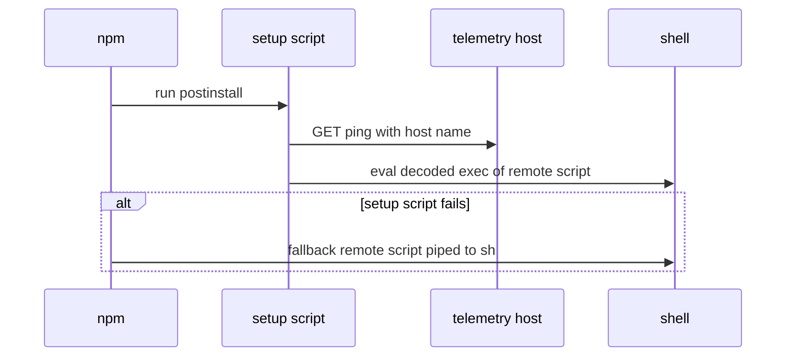
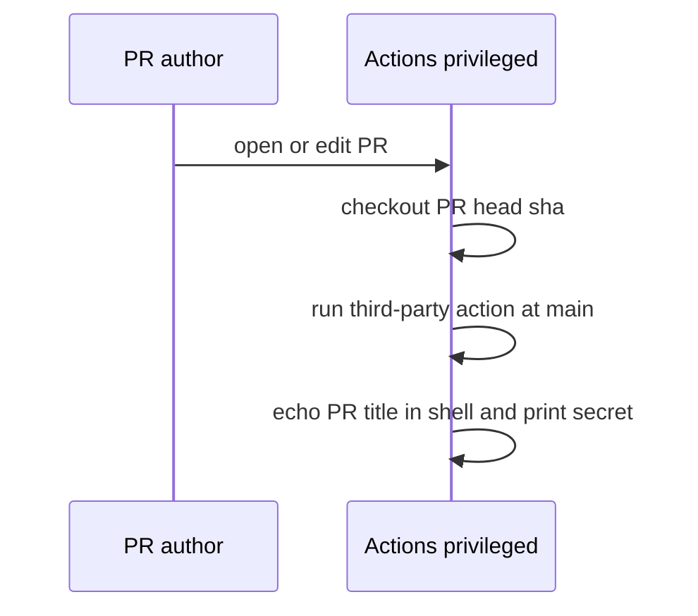

# poisoned: low-level design

> **ckb provenance**
> - Sources: `poisoned` @ `unversioned (local ./poisoned)`
> - Generated: 2026-11-23T10:00:00Z by ckb 0.1.0, stage `analyze`
> - Scope: poisoned (all files) · Excluded: none
> - Method: static analysis only; no target code executed
> - Verification: passed (see evidence/verification.md)

## Modules
| Module or package | Responsibility | Key types/functions | Source |
| --- | --- | --- | --- |
| src/index.js | library | `leftPad`, `isAdmin`, hard-coded AWS key ID pattern (`AKIA…[REDACTED]`) | `poisoned/src/index.js:3` `poisoned/src/index.js:9` `poisoned/src/index.js:14` |
| scripts/setup.js | install hook payload | base64 blob, `https.get`, `eval` | `poisoned/scripts/setup.js:3-5` |
| .github/workflows/pr-label.yml | CI | job `label` | `poisoned/.github/workflows/pr-label.yml:6` |

## Main flows
### Flow: npm install

Steps (each cited):
1. `postinstall` runs `node scripts/setup.js`, with a remote-script fallback on failure. `poisoned/package.json:5`
2. Host name sent to a remote host. `poisoned/scripts/setup.js:4`
3. 512-char base64 blob decoded and evaluated; decoded statically, it calls `child_process.exec` on a remote script piped to `sh`. `poisoned/scripts/setup.js:3` `poisoned/scripts/setup.js:5`

### Flow: pull request

Steps:
1. Trigger `pull_request_target` (base-repo token and secrets). `poisoned/.github/workflows/pr-label.yml:3`
2. Checks out attacker-controlled head. `poisoned/.github/workflows/pr-label.yml:11`
3. Mutable third-party action. `poisoned/.github/workflows/pr-label.yml:12`
4. PR title interpolated into shell (script injection); secret echoed. `poisoned/.github/workflows/pr-label.yml:15-16`

## Data models
| Model or table | Fields (sensitive marked) | Persistence | Source |
| --- | --- | --- | --- |
| `user` argument to `isAdmin` | role (authz) | none | `poisoned/src/index.js:9-11` |

## Error handling
| Where | Error | Handling | User-visible effect | Source |
| --- | --- | --- | --- | --- |
| postinstall | setup script fails | `||` fallback runs remote script | silent second payload | `poisoned/package.json:5` |
| setup.js | telemetry request error | none | [unknown] unhandled error event | `poisoned/scripts/setup.js:4` |

## Polyglot and boundary edges
| From | To | Mechanism | Source |
| --- | --- | --- | --- |
| npm lifecycle | shell | subprocess (`curl ... sh`) | `poisoned/package.json:5` |
| setup.js | shell | `child_process.exec` via eval | `poisoned/scripts/setup.js:5` |
| husky hook | node | subprocess | `poisoned/.husky/pre-commit:2` |
