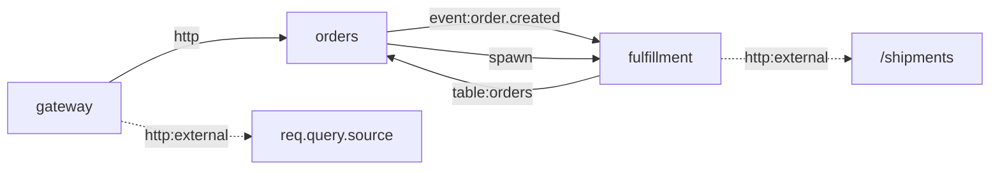

# Call graphs

> **ckb provenance**
> - Sources: `fulfillment` @ `d2ffc2095810`, `gateway` @ `8c8444d8b08d`, `orders` @ `1de64cbb1f39`, `platform` @ `f5659b33e1f9`
> - Generated: 2026-11-24T05:34:58Z by ckb callgraph, stage `callgraph`
> - Scope: registered code repos · Excluded: vendored, generated, binaries, symlinks
> - Method: rolled up from the knowledge graph (static analysis; no target code executed); confidence is the weakest edge on each row
> - Verification: see evidence/graph-verification.md

## Summary

| Level | Nodes | Edges |
| --- | --- | --- |
| function → function | 14 | 12 |
| file → file | 9 | 13 |
| repo → repo | 5 | 6 |

[n/a] counts above are derived from the tables below.

Mechanisms: `call` (resolved call), `http`/`grpc` (client call matched to the endpoint's handler), `spawn` (subprocess or binary), `event:<topic>` (publisher to consumer over a topic), `table:<name>` (writer repo to reader repo), `import`, `package` (internal dependency). Dashed arrows and `inferred` rows rest on medium/low-confidence links: confirm them in the cited code.

## Repo → repo

| From | To | Mechanism | Count | Confidence | Source |
| --- | --- | --- | --- | --- | --- |
| gateway | orders | http | 2 | medium | `gateway/src/server.js:15` `gateway/src/server.js:27` `orders/app/main.py:25` |
| fulfillment | orders | table:orders | 1 | high | `fulfillment/cmd/worker/main.go:35` `orders/app/db.py:23` |
| orders | fulfillment | event:order.created | 1 | high | `orders/app/events.py:24` `fulfillment/internal/queue/consumer.go:30` |
| orders | fulfillment | spawn | 1 | medium | `orders/app/pricing.py:10` `fulfillment/cmd/pricing/main.go:1` |
| fulfillment | /shipments | http:external | 1 | low | `fulfillment/cmd/worker/main.go:28` |
| gateway | req.query.source | http:external | 1 | low | `gateway/src/server.js:32` |

### Shared stores

| Store | Writers | Readers | Source |
| --- | --- | --- | --- |
| orders | fulfillment, orders | orders | `fulfillment/cmd/worker/main.go:35` `orders/app/db.py:14` `orders/app/db.py:23` |

## File → file

Top 13 of 13 by weight.

| From | To | Mechanism | Count | Confidence | Source |
| --- | --- | --- | --- | --- | --- |
| orders/app/main.py | orders/app/db.py | call | 4 | high | `orders/app/main.py:31` `orders/app/main.py:32` |
| gateway/src/server.js | orders/app/main.py | http | 2 | medium | `gateway/src/server.js:15` `gateway/src/server.js:27` |
| fulfillment/cmd/worker/main.go | fulfillment/internal/queue/consumer.go | import | 1 | high | `fulfillment/cmd/worker/main.go:14` |
| gateway/src/server.js | gateway/src/auth.js | import | 1 | high | `gateway/src/server.js:3` |
| orders/app/events.py | fulfillment/internal/queue/consumer.go | event:order.created | 1 | high | `orders/app/events.py:24` `fulfillment/internal/queue/consumer.go:30` |
| orders/app/main.py | orders/app/db.py | import | 1 | high | `orders/app/main.py:7` |
| orders/app/main.py | orders/app/events.py | import | 1 | high | `orders/app/main.py:7` |
| orders/app/main.py | orders/app/events.py | call | 1 | high | `orders/app/main.py:33` |
| orders/app/main.py | orders/app/pricing.py | import | 1 | high | `orders/app/main.py:7` |
| orders/app/main.py | orders/app/pricing.py | call | 1 | high | `orders/app/main.py:29` |
| gateway/src/server.js | gateway/src/auth.js | call | 1 | medium | `gateway/src/server.js:31` |
| orders/app/pricing.py | fulfillment/cmd/pricing/main.go | spawn | 1 | medium | `orders/app/pricing.py:10` `fulfillment/cmd/pricing/main.go:1` |
| fulfillment/cmd/worker/main.go | fulfillment/internal/queue/consumer.go | call | 1 | low | `fulfillment/cmd/worker/main.go:26` |

## Function → function

Top 12 of 12: cross-file and cross-repo edges first.

| From | To | Mechanism | Count | Confidence | Source |
| --- | --- | --- | --- | --- | --- |
| orders: publish_order_created | fulfillment: Consume | event:order.created | 1 | high | `orders/app/events.py:24` `fulfillment/internal/queue/consumer.go:30` |
| gateway: route GET /orders/:id | orders: read_order | http | 1 | medium | `gateway/src/server.js:27` `orders/app/main.py:37` |
| gateway: route POST /orders | orders: create_order | http | 1 | medium | `gateway/src/server.js:15` `orders/app/main.py:25` |
| orders: price_items | fulfillment: main | spawn | 1 | medium | `orders/app/pricing.py:10` `fulfillment/cmd/pricing/main.go:1` |
| orders: create_order | orders: get_conn | call | 1 | high | `orders/app/main.py:31` |
| orders: create_order | orders: insert_order | call | 1 | high | `orders/app/main.py:32` |
| orders: create_order | orders: publish_order_created | call | 1 | high | `orders/app/main.py:33` |
| orders: create_order | orders: price_items | call | 1 | high | `orders/app/main.py:29` |
| orders: read_order | orders: get_conn | call | 1 | high | `orders/app/main.py:39` |
| orders: read_order | orders: get_order | call | 1 | high | `orders/app/main.py:39` |
| gateway: route GET /admin/report | gateway: requireRole | call | 1 | medium | `gateway/src/server.js:31` |
| fulfillment: main | fulfillment: Consume | call | 1 | low | `fulfillment/cmd/worker/main.go:26` |

Full machine-readable data: `graph/callgraph.json`. Per-repo diagrams: `diagrams/callgraph-<level>-<repo>.mmd`.
