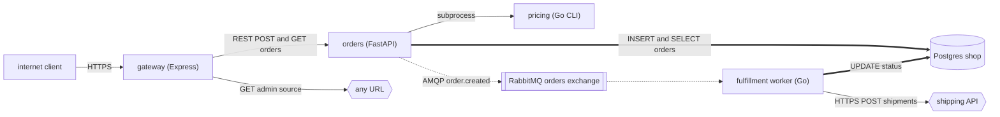
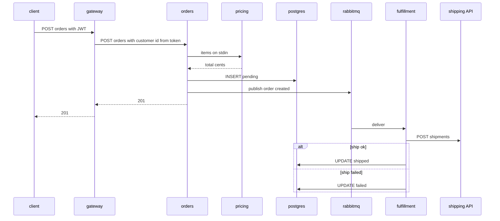
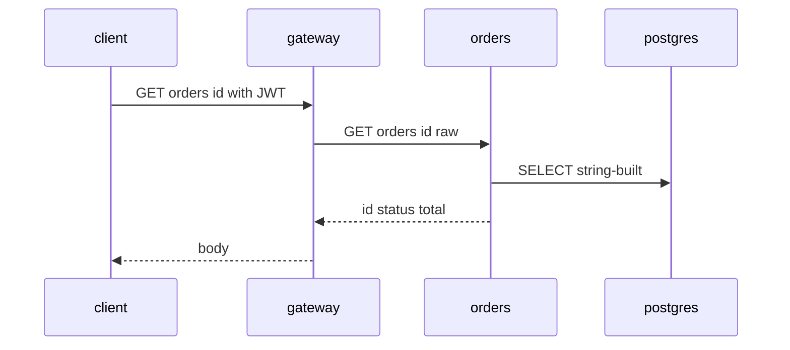

# System data flows

> **ckb provenance**
> - Sources: `gateway`, `orders`, `fulfillment`, `platform`, `poisoned` @ `unversioned (local)`
> - Generated: 2026-11-23T10:00:00Z by ckb 0.1.0, stage `flow-trace`
> - Scope: all five registered repos · Excluded: none
> - Method: static analysis only; no target code executed
> - Verification: passed (see evidence/verification.md)

## Edges
| # | From | To | Kind | Mechanism | Producer evidence | Consumer evidence | Confidence |
| --- | --- | --- | --- | --- | --- | --- | --- |
| E1 | internet | gateway | sync | Ingress `shop.example.com` → gateway:3000 | `platform/deploy/k8s/gateway.yaml:27` «- host: shop.example.com» | `gateway/src/server.js:36` | high |
| E2 | gateway | orders | sync + contract | REST POST /orders (OpenAPI `createOrder`); URL via `ORDERS_URL` = `http://orders:8000` | `gateway/src/server.js:15` «axios.post(`${ORDERS_URL}/orders`» `platform/deploy/docker-compose.yml:6` «ORDERS_URL: http://orders:8000» | `orders/app/main.py:25` «@app.post("/orders", status_code=201)» `platform/contracts/orders.openapi.yaml:8` «operationId: createOrder» | high |
| E3 | gateway | orders | sync + contract | REST GET /orders/{id} (OpenAPI `getOrder`) | `gateway/src/server.js:27` | `orders/app/main.py:37` «@app.get("/orders/{order_id}")» `platform/contracts/orders.openapi.yaml:23` «operationId: getOrder» | high |
| E4 | orders | fulfillment | async + contract | AMQP topic exchange `orders`, key `order.created` → queue `fulfillment.order-created` | `orders/app/events.py:7-8` `orders/app/events.py:24` | `fulfillment/internal/queue/consumer.go:30` «ch.QueueBind(q.Name, "order.created", "orders", false, nil)» `platform/contracts/order_created.schema.json:2` | high |
| E5 | orders | pricing (fulfillment/cmd/pricing) | polyglot | subprocess JSON stdin/stdout | `orders/app/pricing.py:10` | `fulfillment/cmd/pricing/main.go:18` «json.NewDecoder(os.Stdin).Decode(&items)» | high (link) / binary not shipped in either image [inferred] |
| E6 | orders | Postgres `shop.orders` | shared-state | INSERT (parameterized), SELECT (string-built) | `orders/app/db.py:15` `orders/app/db.py:23` | table `orders` also written by E7 | high |
| E7 | fulfillment | Postgres `shop.orders` | shared-state | UPDATE status (parameterized) | `fulfillment/cmd/worker/main.go:35` «UPDATE orders SET status = $1 WHERE id = $2» | read back by orders `orders/app/db.py:23` | high |
| E8 | fulfillment | external shipping API | sync (external) | HTTPS POST /shipments, bearer key | `fulfillment/cmd/worker/main.go:28-29` | `platform/deploy/docker-compose.yml:18` «SHIPPING_API_URL: https://api.shipping.example.com» | medium (consumer out of scope) |
| E9 | gateway | arbitrary host | sync (external) | GET `?source=` (admin) | `gateway/src/server.js:32` | [unknown] | medium |
| E10 | poisoned | none | n/a | no in-scope repo depends on `left-pad-utils` | `poisoned/package.json:2` | `gateway/package.json:6-10` (no reference) | high (absence) |

## System flow diagram

Nodes and edges cited in the Edges table (`gateway/src/server.js:15` `orders/app/events.py:24` `fulfillment/cmd/worker/main.go:35`).

## End-to-end flows
### Place order and ship

Steps: `gateway/src/server.js:13-19`, `orders/app/main.py:29-34`, `fulfillment/internal/queue/consumer.go:37-49`, `fulfillment/cmd/worker/main.go:27-35`.

### Read order

Steps: `gateway/src/server.js:26-28`, `orders/app/main.py:38-42`, `orders/app/db.py:23`.

## Contract drift
| Item | Producer side | Consumer or contract side | Note |
| --- | --- | --- | --- |
| `shipping_address` in request | `orders/app/main.py:22` «shipping_address: str» | `platform/contracts/orders.openapi.yaml:34-40` (absent) | OpenAPI `OrderRequest` omits a field orders accepts |
| status enum `priced` | no code sets `priced`; fulfillment sets `shipped`/`failed` `fulfillment/cmd/worker/main.go:31-33` | `platform/contracts/orders.openapi.yaml:45` «enum: [pending, priced, shipped, failed]» | unused enum value [inferred] |
| event payload vs schema | `orders/app/events.py:18-23` | `platform/contracts/order_created.schema.json:4-9` `fulfillment/internal/queue/consumer.go:10-15` | consistent field names; `shipping_address` nullable in producer but typed `string` in schema [inferred] |
| `x-request-user` header | `gateway/src/server.js:17` | `orders/app/main.py:26` (accepted, never used) | trusted-header channel exists but is ignored |

## Unmatched endpoints
| Side | Endpoint | Source | Why unmatched |
| --- | --- | --- | --- |
| consumer | GET /healthz | `gateway/src/server.js:11` | [unknown] no probe configured in the K8s Deployment `platform/deploy/k8s/gateway.yaml:13-19` |
| producer | POST shipments | `fulfillment/cmd/worker/main.go:28` | [unknown] external API, not in scope |
| producer | admin report fetch | `gateway/src/server.js:32` | [unknown] caller-chosen target |
| producer | pricing binary in orders image | `orders/app/pricing.py:5` | [unknown] binary built in `fulfillment/Dockerfile:4` but not copied into any final image `fulfillment/Dockerfile:7` |
