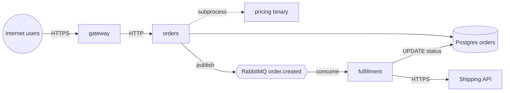
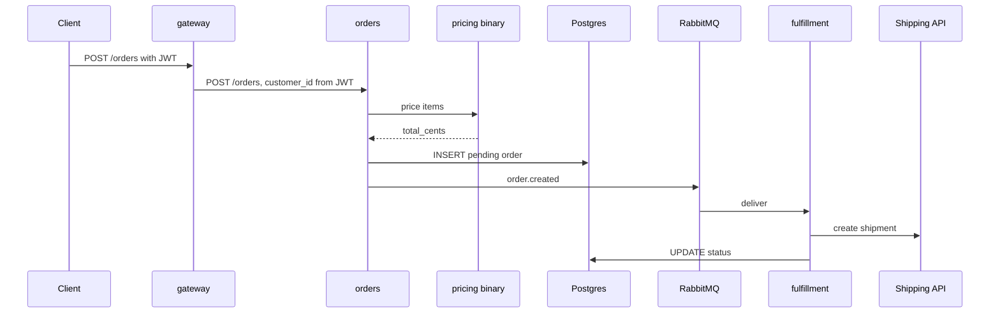

# System data flows

> **ckb provenance**
> - Sources: `gateway` @ `8c8444d`, `orders` @ `1de64cb` (main snapshot), `fulfillment` @ `d2ffc20`, `platform` @ `f5659b3`; context `ctx-platform`
> - Generated: 2026-11-24T05:27:54Z by ckb 0.1.0, stage `flow-tracing`
> - Scope: all four repos plus supplied context · Excluded: vendored, generated, binaries, symlinks (none present)
> - Method: static analysis only; no target code executed
> - Verification: passed (37 citations, 0 errors; see evidence/verification.md)

## Edges
| # | From | To | Kind | Mechanism | Producer evidence | Consumer evidence | Confidence |
| --- | --- | --- | --- | --- | --- | --- | --- |
| 1 | gateway POST /orders | orders POST /orders | sync | REST; base URL from `ORDERS_URL`, matched by compose value `http://orders:8000` and the contract path | `gateway/src/server.js:15` «axios.post(`${ORDERS_URL}/orders`» | `orders/app/main.py:25` «@app.post("/orders", status_code=201)» | high |
| 2 | gateway GET /orders/:id | orders GET /orders/{order_id} | sync | REST, id placed in the URL path | `gateway/src/server.js:27` «axios.get(`${ORDERS_URL}/orders/${req.params.id}`» | `orders/app/main.py:37` «@app.get("/orders/{order_id}")» | high |
| 3 | orders `price_items` | fulfillment `cmd/pricing` | polyglot | subprocess over stdin/stdout; binary path from `PRICING_BIN`, doc string names the Go package | `orders/app/pricing.py:10` «subprocess.run([PRICING_BIN, "--json"]» | `fulfillment/cmd/pricing/main.go:18` «json.NewDecoder(os.Stdin).Decode(&items)» | medium |
| 4 | orders `publish_order_created` | fulfillment `Consume` | async | RabbitMQ exchange `orders`, key `order.created`; payload fields match the JSON Schema contract | `orders/app/events.py:24` «ch.basic_publish(exchange=EXCHANGE, routing_key=ROUTING_KEY, body=body)» | `fulfillment/internal/queue/consumer.go:30` «ch.QueueBind(q.Name, "order.created", "orders", false, nil)» | high |
| 5 | orders `insert_order` / `get_order` | Postgres table `orders` | shared-state | SQL | `orders/app/db.py:14` | `orders/app/db.py:23` | high |
| 6 | fulfillment handler | Postgres table `orders` | shared-state | SQL UPDATE of status | `fulfillment/cmd/worker/main.go:35` «UPDATE orders SET status = $1 WHERE id = $2» | `orders/app/db.py:23` | high |
| 7 | fulfillment handler | external shipping API | external | HTTPS by deployment value; bearer API key | `fulfillment/cmd/worker/main.go:28` «shippingURL+"/shipments"» | `platform/deploy/docker-compose.yml:18` «SHIPPING_API_URL: https://api.shipping.example.com» | medium |
| 8 | gateway GET /admin/report | caller-chosen URL | external | HTTP GET of `req.query.source` | `gateway/src/server.js:32` «axios.get(`${req.query.source}`» | [unknown] target is chosen by the caller | low |

Contract matching: `platform/contracts/order_created.schema.json` lists order_id, customer_id, total_cents (required) and shipping_address, matching the producer body and the consumer struct. `platform/contracts/order_created.schema.json:4` `orders/app/events.py:18` `fulfillment/internal/queue/consumer.go:10`

## System flow diagram
[inferred] Summary of the cited edges above.

## End-to-end flows
### Create an order

Steps: gateway auth `gateway/src/server.js:13`, forward `gateway/src/server.js:15`, price `orders/app/main.py:29`, insert `orders/app/main.py:32`, publish `orders/app/main.py:33`, consume `fulfillment/internal/queue/consumer.go:37`, ship and update `fulfillment/cmd/worker/main.go:28` `fulfillment/cmd/worker/main.go:35`.

## Unmatched endpoints
| Side | Endpoint | Source | Why unmatched |
| --- | --- | --- | --- |
| producer | gateway GET /admin/report target (`req.query.source`) | `gateway/src/server.js:32` | destination chosen by the caller at run time: [unknown] |
| contract | gateway routes `/healthz`, `/admin/report` are absent from the OpenAPI file | `platform/contracts/orders.openapi.yaml:5` | contract describes only the orders API |
| contract | `shipping_address` accepted by orders but absent from `OrderRequest` in the contract (contract drift) | `orders/app/main.py:22` «shipping_address: str | None = None» | `platform/contracts/orders.openapi.yaml:36` lists only customer_id, items, card_last4 |
| contract | status `priced` is allowed by the contract but no code writes it [inferred] | `platform/contracts/orders.openapi.yaml:47` «enum: [pending, priced, shipped, failed]» | only `pending`, `shipped`, `failed` appear in code: `orders/app/db.py:15` `fulfillment/cmd/worker/main.go:31` |

## Security-relevant observations
- Table `orders` has two writers (orders, fulfillment). `orders/app/db.py:14` `fulfillment/cmd/worker/main.go:35`
- Internal channels carry no authentication in code: orders' two routes, and the broker consume path. `orders/app/main.py:25` `fulfillment/internal/queue/consumer.go:18`
