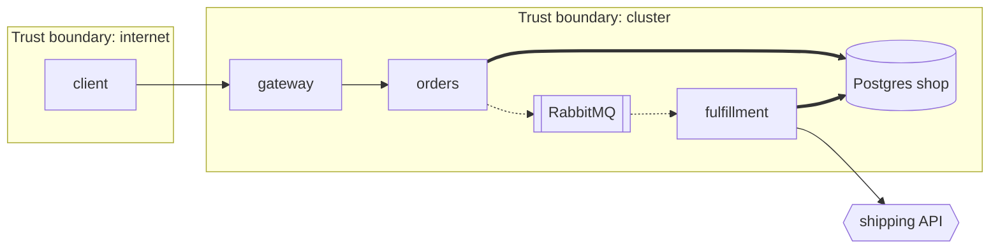
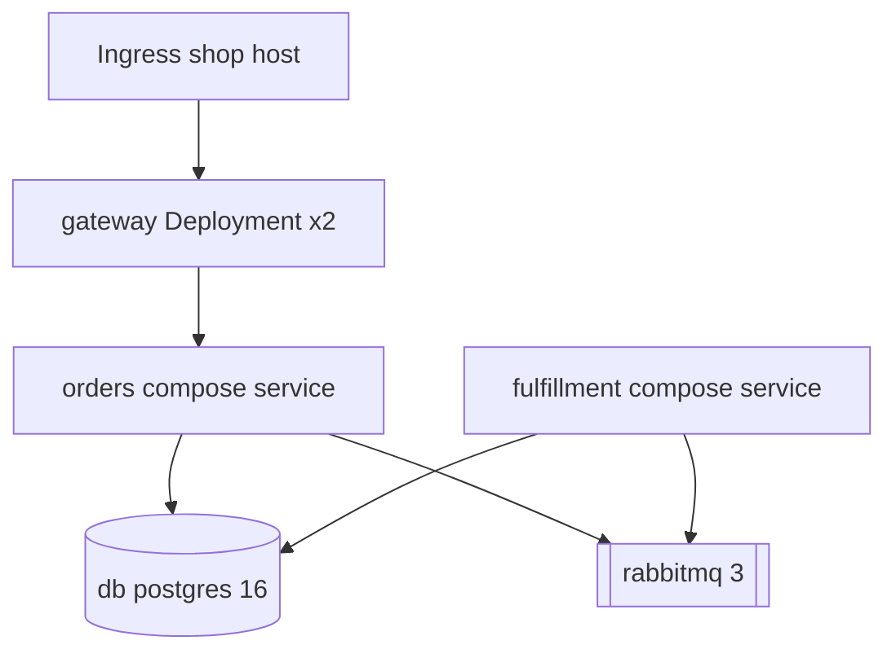

# System: high-level design

> **ckb provenance**
> - Sources: `gateway`, `orders`, `fulfillment`, `platform`, `poisoned` @ `unversioned (local)`
> - Generated: 2026-11-23T10:00:00Z by ckb 0.1.0, stage `flow-trace`
> - Scope: all five registered repos · Excluded: none
> - Method: static analysis only; no target code executed
> - Verification: passed (see evidence/verification.md)

## Components and responsibilities
| Component | Responsibility | Tech | Source |
| --- | --- | --- | --- |
| gateway | public API, JWT auth, proxy to orders, admin report | Node/Express | `gateway/src/server.js:8-36` |
| orders | create/read orders, pricing via subprocess, publish events | Python/FastAPI | `orders/app/main.py:9-42` |
| fulfillment worker | consume events, ship, update status | Go | `fulfillment/cmd/worker/main.go:17-41` |
| pricing CLI | compute totals | Go | `fulfillment/cmd/pricing/main.go:14-26` |
| Postgres `shop` | orders table, shared by orders and fulfillment | postgres:16 | `platform/deploy/docker-compose.yml:19-20` |
| RabbitMQ | `orders` topic exchange | rabbitmq:3-management | `platform/deploy/docker-compose.yml:21-22` |
| poisoned (`left-pad-utils`) | standalone hostile package; not wired into the system | npm | `poisoned/package.json:2` |

## Boundaries and external dependencies
| Boundary or external system | Direction | Protocol | Source |
| --- | --- | --- | --- |
| Internet → gateway (Ingress) | inbound | HTTP(S) | `platform/deploy/k8s/gateway.yaml:27-33` |
| gateway → orders (cluster network, no service auth) | internal | HTTP | `gateway/src/server.js:15` `orders/app/main.py:25` |
| services → RabbitMQ (no credentials in compose URLs) | internal | AMQP | `platform/deploy/docker-compose.yml:12` `platform/deploy/docker-compose.yml:17` |
| services → Postgres (separate DB users) | internal | SQL | `platform/deploy/docker-compose.yml:11` `platform/deploy/docker-compose.yml:16` |
| fulfillment → shipping API | outbound third party | HTTPS | `fulfillment/cmd/worker/main.go:28` |
| gateway → any URL | outbound | HTTP(S) | `gateway/src/server.js:32` |

## Component diagram

Edges: see `system/data-flows.md`; anchors `gateway/src/server.js:15` `orders/app/events.py:24` `fulfillment/cmd/worker/main.go:35`.

## Deployment topology

K8s exists only for gateway (`platform/deploy/k8s/gateway.yaml:1-33`); the rest is compose only (`platform/deploy/docker-compose.yml:1-22`). Production topology for orders and fulfillment `[unknown]`.

## Key design decisions and constraints
| Decision or constraint | Evidence | Label | Confidence |
| --- | --- | --- | --- |
| Authentication only at the edge; internal services trust the network | `gateway/src/auth.js:6` `orders/app/main.py:25-38` | observed | high |
| Event-driven fulfillment with manual ack | `fulfillment/internal/queue/consumer.go:33` | observed | high |
| Shared database, two writers | `orders/app/db.py:15` `fulfillment/cmd/worker/main.go:35` | observed | high |
| Cross-language pricing via subprocess | `orders/app/pricing.py:10` | observed | high |
| Least-privilege DB users per service | `platform/deploy/docker-compose.yml:11` `platform/deploy/docker-compose.yml:16` | [inferred] grants not in scope | low |
