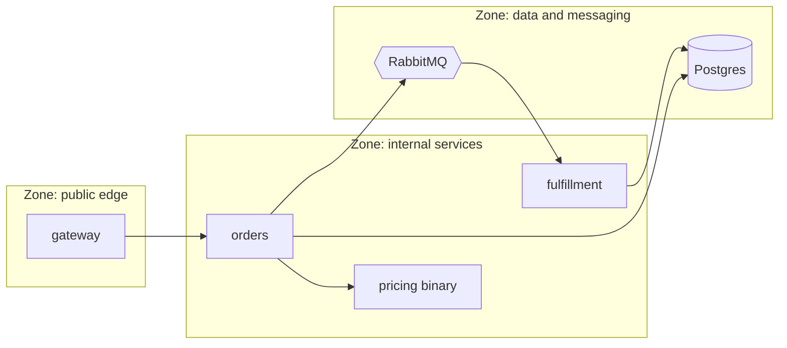
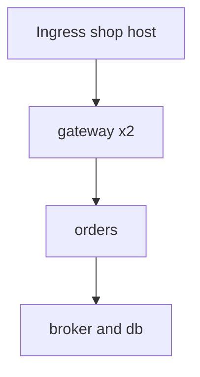

# System: high-level design

> **ckb provenance**
> - Sources: `gateway` @ `8c8444d`, `orders` @ `1de64cb` (main snapshot), `fulfillment` @ `d2ffc20`, `platform` @ `f5659b3`; context `ctx-platform`
> - Generated: 2026-11-24T05:27:54Z by ckb 0.1.0, stage `flow-tracing`
> - Scope: all four repos plus supplied context · Excluded: vendored, generated, binaries, symlinks (none present)
> - Method: static analysis only; no target code executed
> - Verification: passed (36 citations, 0 errors; see evidence/verification.md)

## Components and responsibilities
| Component | Responsibility | Tech | Source |
| --- | --- | --- | --- |
| gateway | public edge, JWT auth, request forwarding | Node/Express | `gateway/src/server.js:13` |
| orders | order API, pricing call, persistence, event publishing | Python/FastAPI | `orders/app/main.py:25` |
| fulfillment worker | consumes events, ships, updates status | Go | `fulfillment/cmd/worker/main.go:26` |
| pricing binary | flat price computation | Go CLI | `fulfillment/cmd/pricing/main.go:23` |
| platform | IaC, contracts, docs | Terraform, Bicep, CFN, K8s | `platform/deploy/k8s/gateway.yaml:1` |

## Boundaries and external dependencies
| Boundary or external system | Direction | Protocol | Source |
| --- | --- | --- | --- |
| internet to gateway (K8s Ingress, security group, NSG) | in | HTTP on 3000 | `platform/deploy/k8s/gateway.yaml:27` `platform/deploy/terraform/aws/main.tf:19` |
| gateway to orders | out | HTTP, plain by default | `gateway/src/server.js:5` «http://orders:8000» |
| orders to RabbitMQ | out | AMQP, plain by default | `orders/app/events.py:6` «RABBITMQ_URL = os.environ.get("RABBITMQ_URL"» |
| fulfillment to shipping API | out | HTTPS by deployment value | `platform/deploy/docker-compose.yml:18` |
| gateway to caller-chosen URL | out | HTTP | `gateway/src/server.js:32` |

## Component diagram
[inferred] Summary of the components table above.

## Deployment topology
Compose runs gateway, orders, fulfillment, db and rabbitmq on one network, publishing only gateway port 3000. `platform/deploy/docker-compose.yml:4` Kubernetes only defines the gateway Deployment and Ingress; orders and fulfillment workloads are [unknown]. `platform/deploy/k8s/gateway.yaml:3`

## Cloud resources (from IaC and CSPM)
| Resource | Type | Provider | Exposure | Open CSPM findings | Source |
| --- | --- | --- | --- | --- | --- |
| invoices | S3 bucket | AWS | public-read | yes (Prowler) | `platform/deploy/terraform/aws/main.tf:8` `ctx-platform/prowler-ocsf.json.md:18` |
| shop | RDS Postgres | AWS | unencrypted storage | yes (several) | `platform/deploy/terraform/aws/main.tf:30` `ctx-platform/defender-assessments.json.md:16` |
| orders | Amazon MQ RabbitMQ | AWS | not public | yes (Security Hub, Wiz) | `platform/deploy/terraform/aws/main.tf:40` `ctx-platform/securityhub-asff.json.md:18` |
| exports | GCS bucket | GCP | allUsers viewer | no corroboration | `platform/deploy/terraform/gcp/main.tf:10` |
| allow-admin | GCE firewall | GCP | SSH from the internet | yes (SCC) | `platform/deploy/terraform/gcp/main.tf:16` `ctx-platform/gcp-scc-findings.json.md:16` |
| reports | Azure storage | Azure | public blob, TLS 1.0 | yes (Defender) | `platform/deploy/azure/main.bicep:10` `ctx-platform/defender-assessments.json.md:16` |

## Documented vs observed
Full table: `system/documented-vs-observed.md` (11 drift rows, 6 consistent, 2 unmatched claims). Highlights:
| Claim (documented) | Source | Observed | Evidence | Verdict |
| --- | --- | --- | --- | --- |
| All service-to-service traffic uses mTLS | `ctx-platform/security-design.docx.md:14` | gateway calls orders over plain http by default | `gateway/src/server.js:5` | drift |
| orders validates the caller JWT on every request | `ctx-platform/security-design.docx.md:18` | no auth on either orders route | `orders/app/main.py:25` | drift |
| database encrypted at rest | `ctx-platform/security-design.docx.md:22` | `storage_encrypted = false` | `platform/deploy/terraform/aws/main.tf:30` | drift |
| RabbitMQ over TLS | `ctx-platform/architecture.drawio.md:18` | plain `amqp://` default | `orders/app/events.py:6` | drift |
| orders is internal only | `ctx-platform/security-design.docx.md:16` | only the gateway calls it; no ingress found to orders | `gateway/src/server.js:15` | consistent |

## Key design decisions and constraints
| Decision or constraint | Evidence | Label | Confidence |
| --- | --- | --- | --- |
| RabbitMQ topic exchange for order events so services scale and fail independently | `platform/docs/adr/0001-use-rabbitmq-for-order-events.md:5` | [documented] | high |
| Gateway is the only public entry; orders trusts its network position | `orders/app/main.py:25` | [inferred] | medium |
