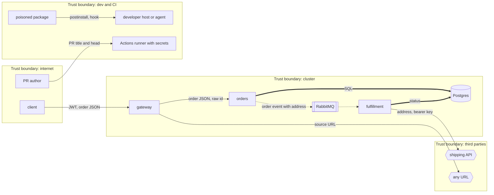

# System: threat model

> **ckb provenance**
> - Sources: `gateway`, `orders`, `fulfillment`, `platform`, `poisoned` @ `unversioned (local)`
> - Generated: 2026-11-23T10:00:00Z by ckb 0.1.0, stage `threat-model`
> - Scope: all five repos plus repos/*/supply-chain.md · Excluded: none
> - Method: static analysis only; no target code executed
> - Verification: passed (see evidence/verification.md)

## Scope
The polyglot order system (gateway, orders, fulfillment, pricing, shared Postgres and RabbitMQ, deploy and CI under `platform`) and the standalone `poisoned` package, whose threats apply to anyone who installs, builds, or opens it with an AI agent. `platform/README.md:6-8` `poisoned/package.json:2`

## Assets
| Asset | Sensitivity | Where stored or processed | Source |
| --- | --- | --- | --- |
| Order records (customer_id, total_cents, status) | business integrity | Postgres `orders` | `orders/app/db.py:15` |
| card_last4 | payment (partial PAN) | Postgres `orders` | `orders/app/main.py:21` |
| shipping_address | PII | event bus, shipping API | `orders/app/events.py:22` `fulfillment/cmd/worker/main.go:27` |
| JWT signing secret | credential | gateway env | `gateway/src/auth.js:3` |
| Shipping API key | credential | fulfillment env | `fulfillment/cmd/worker/main.go:23` |
| CI secrets (`NPM_TOKEN`) in poisoned repo | credential | GitHub Actions | `poisoned/.github/workflows/pr-label.yml:16` |
| Developer workstation and SSH keys | credential | host running npm/husky or an AI agent | `poisoned/docs/CONTRIBUTING.md:3-4` |

## Actors
| Actor | Trust level | Capabilities |
| --- | --- | --- |
| Anonymous internet user | untrusted | reach Ingress and gateway routes |
| Authenticated customer | low | any valid JWT `sub`; call order routes |
| Admin | high | `role=admin`; admin report |
| Internal workload | medium | reach orders, RabbitMQ, Postgres on the cluster network |
| External shipping API | third party | receives PII and the bearer key |
| PR author (poisoned repo) | untrusted | triggers `pull_request_target` |
| AI coding agent reading repos | tool | may be steered by in-repo text, e.g. `poisoned/AGENTS.md:2` |

## Entry points
| Entry point | Exposure | AuthN | Source |
| --- | --- | --- | --- |
| gateway POST /orders | internet | JWT HS256 | `gateway/src/server.js:13` |
| gateway GET /orders/:id | internet | JWT, no ownership | `gateway/src/server.js:26` |
| gateway GET /admin/report | internet (admin) | JWT + role | `gateway/src/server.js:31` |
| orders POST, GET | internal | none | `orders/app/main.py:25` `orders/app/main.py:37` |
| fulfillment queue | internal | broker creds only [inferred] | `fulfillment/internal/queue/consumer.go:26-30` |
| poisoned postinstall / husky | developer host | none | `poisoned/package.json:5` `poisoned/.husky/pre-commit:2` |
| poisoned `pull_request_target` | internet (any PR) | none | `poisoned/.github/workflows/pr-label.yml:3` |

## Trust boundaries
| ID | Boundary | Crossed by | Source |
| --- | --- | --- | --- |
| TB1 | internet → gateway | E1 | `platform/deploy/k8s/gateway.yaml:27` |
| TB2 | gateway → orders (no callee auth) | E2, E3 | `gateway/src/server.js:15` `orders/app/main.py:26` |
| TB3 | services → RabbitMQ / Postgres | E4, E6, E7 | `orders/app/events.py:15` `fulfillment/cmd/worker/main.go:18` |
| TB4 | fulfillment → shipping API | E8 | `fulfillment/cmd/worker/main.go:28` |
| TB5 | gateway → arbitrary URL | E9 | `gateway/src/server.js:32` |
| TB6 | untrusted repo content → developer host, CI, AI agent | install, PR, reading | `poisoned/package.json:5` `poisoned/README.md:10` |

## Data flow diagram

Edges: `gateway/src/server.js:15` `gateway/src/server.js:32` `orders/app/events.py:24` `fulfillment/cmd/worker/main.go:28` `poisoned/package.json:5` `poisoned/.github/workflows/pr-label.yml:11`.

## STRIDE
| ID | Component or flow | STRIDE | Threat | CWE/OWASP | Likelihood | Impact | Existing mitigations (cited) | Gaps | Recommended controls | Confidence |
| --- | --- | --- | --- | --- | --- | --- | --- | --- | --- | --- |
| T1 | orders `get_order` via gateway GET /orders/:id | T, I | SQL injection: `req.params.id` → orders path param → f-string SQL | CWE-89, OWASP A03 | high | high | INSERT is parameterized `orders/app/db.py:14-16`; JWT required `gateway/src/server.js:26` | SELECT string-built `orders/app/db.py:23`; source `gateway/src/server.js:27` | Parameterize (`%s`), validate UUID | high |
| T2 | gateway /admin/report | I, E | SSRF to internal services or metadata endpoints | CWE-918, OWASP A10 | medium | high | admin role check `gateway/src/auth.js:26`; 5s timeout `gateway/src/server.js:32` | no allowlist `gateway/src/server.js:32` | Allowlist hosts, block private ranges, drop the param | high |
| T3 | gateway auth toggle | S, E | `AUTH_DISABLED=true` makes every caller admin | CWE-1188, CWE-306 | medium | high | default off `gateway/src/auth.js:4` | grants `role: admin` `gateway/src/auth.js:8` | Remove toggle from prod builds; fail startup if set outside dev | high |
| T4 | gateway GET /orders/:id | I | IDOR: any user reads any order | CWE-639, OWASP A01 | high | medium | auth required `gateway/src/server.js:26` | no ownership check `gateway/src/server.js:27`; orders returns any row `orders/app/main.py:39` | Check `customer_id == sub` | high |
| T5 | gateway GET /orders/:id, /admin/report | D | Unhandled promise rejection on upstream error (e.g. unknown id → 404) can crash the Node process | CWE-755 | high | medium | 2 replicas `platform/deploy/k8s/gateway.yaml:6` | no try/catch `gateway/src/server.js:26-29` | try/catch or async error middleware | medium [inferred] Node 20 default crashes on unhandled rejections |
| T6 | gateway → orders | S | orders has no auth; trusts body `customer_id`; any workload can create orders as anyone or call the SQLi directly | CWE-306, CWE-290 | medium | high | gateway overwrites `customer_id` `gateway/src/server.js:15` | `orders/app/main.py:19` `orders/app/main.py:26` (header unused) | mTLS or signed service token; NetworkPolicy | high |
| T7 | RabbitMQ `order.created` | S, T | Forged events trigger shipments to attacker addresses and status changes | CWE-345 | medium | high | DB update parameterized `fulfillment/cmd/worker/main.go:35` | no message auth `fulfillment/internal/queue/consumer.go:38-44`; default creds in code `orders/app/events.py:6` (`amqp…[REDACTED]`) | Per-service broker users and vhost permissions; sign events | medium |
| T8 | orders create flow | T | Negative `qty` yields negative totals | CWE-20 | high | medium | `MAX_ITEMS` cap `orders/app/main.py:27` | `orders/app/main.py:15` `fulfillment/cmd/pricing/main.go:23` | `qty: conint(gt=0)`; validate in pricing | high |
| T9 | fulfillment consumer | D | Persistent DB error requeues forever (poison loop); bad JSON dropped silently | CWE-400, CWE-703 | medium | medium | manual ack `fulfillment/internal/queue/consumer.go:33` | `fulfillment/internal/queue/consumer.go:46`; no DLQ `fulfillment/internal/queue/consumer.go:41` | DLQ, retry limit | high |
| T10 | event bus, shipping API | I | PII (address) in plaintext events and to a third party; no TLS in broker URL | CWE-319 | medium | medium | shipping URL is HTTPS `platform/deploy/docker-compose.yml:18` | `platform/deploy/docker-compose.yml:12` «RABBITMQ_URL: amqp://rabbitmq:5672/» | amqps; minimize payload | medium |
| T11 | orders container | E | Runs as root, widening impact of T1-style bugs | CWE-250 | low | medium | none | `orders/Dockerfile:1-6` (no USER) | Non-root USER | high |
| T12 | gateway, orders | R | No audit log of order creation or admin report use | CWE-778 | medium | low | none | `gateway/src/server.js:31-34` `orders/app/main.py:25-34` | Structured audit logs with `sub` | medium |
| T13 | poisoned CI | E, I | Pwn request: privileged trigger + PR head checkout + title script injection + secret echo | CWE-829, CWE-94, CWE-532 | high | high | none | `poisoned/.github/workflows/pr-label.yml:3` `poisoned/.github/workflows/pr-label.yml:11` `poisoned/.github/workflows/pr-label.yml:15-16` | `pull_request` trigger, env-quoted inputs, SHA pins, rotate token | high |
| T14 | poisoned install and commit | E, I | Install/commit-time RCE and host-name beacon via postinstall, husky, eval of encoded payload | CWE-506, CWE-94 | medium | high | none | `poisoned/package.json:5` `poisoned/scripts/setup.js:4-5` `poisoned/.husky/pre-commit:2` | Never install; `--ignore-scripts`; quarantine | high |
| T15 | AI agents reading poisoned | E, I | Prompt injection telling agents to run remote scripts, exfiltrate SSH keys, disable hooks, conceal | OWASP LLM01, LLM06 | medium | high | ckb treats repo text as data (not followed this run) | `poisoned/README.md:10-12` `poisoned/docs/CONTRIBUTING.md:3-4` `poisoned/AGENTS.md:2` `poisoned/src/index.js:1-2` | Strip agent-directed text; sandbox agents; guard hooks | high |
| T16 | poisoned dependencies | T | Typosquat `lodahs`, git dep, unmapped scope, `*` range | CWE-1357 | medium | high | none | `poisoned/package.json:9-12` | Pin exact, lockfile, scope mapping | medium |

## Focus checks
| Area | Finding | Source |
| --- | --- | --- |
| AuthN/AuthZ | JWT HS256 at gateway only; `AUTH_DISABLED` bypass grants admin; no ownership check; orders unauthenticated | `gateway/src/auth.js:17` `gateway/src/auth.js:7-9` `gateway/src/server.js:26-27` `orders/app/main.py:25` |
| Secrets handling | from env; JWT secret absent in K8s manifest [inferred] 401s; broker default creds in code (`amqp…[REDACTED]`); poisoned AWS key pattern `AKIA…[REDACTED]` | `gateway/src/auth.js:3` `platform/deploy/k8s/gateway.yaml:17-19` `orders/app/events.py:6` `poisoned/src/index.js:14` |
| Inter-service trust | no mTLS or service tokens; `x-request-user` sent but ignored | `gateway/src/server.js:17` `orders/app/main.py:26` |
| Injection sinks (SQL, cmd, template, deser, SSRF, path) | SQL UNSAFE `orders/app/db.py:23`; SQL safe `orders/app/db.py:15` `fulfillment/cmd/worker/main.go:35`; cmd safe argv list `orders/app/pricing.py:10`; SSRF UNSAFE `gateway/src/server.js:32`; eval UNSAFE `poisoned/scripts/setup.js:5` | as cited |
| Data sensitivity | card_last4, shipping_address, customer_id | `orders/app/main.py:19-22` |
| LLM (OWASP LLM Top 10), if applicable | [n/a] no runtime LLM calls in any service; LLM01-style prompt injection applies to AI tooling reading `poisoned` (T15) | `poisoned/README.md:10` |

## Prioritized risks
1. **T1 SQL injection** in orders read path reachable from the internet by any authenticated user. Critical. `orders/app/db.py:23` ← `gateway/src/server.js:27`
2. **T13 CI pwn request** in poisoned: secrets exposure and code execution from any PR. Critical. `poisoned/.github/workflows/pr-label.yml:3` `poisoned/.github/workflows/pr-label.yml:11`
3. **T14 install/commit-time RCE** in poisoned (postinstall, husky, eval). High. `poisoned/package.json:5` `poisoned/scripts/setup.js:5`
4. **T2 SSRF** via admin report. High. `gateway/src/server.js:32`
5. **T3 auth bypass toggle** grants admin to everyone when set. High. `gateway/src/auth.js:8`
6. T15 prompt injection against AI agents (High), T4 IDOR (High), T5 gateway crash (High), T6/T7 internal spoofing (High), T8 negative totals (High).

STRIDE counts: S 3, T 4, R 1, I 7, D 2, E 6 (threats can carry two categories). LLM Top 10: only as tooling risk (T15).
