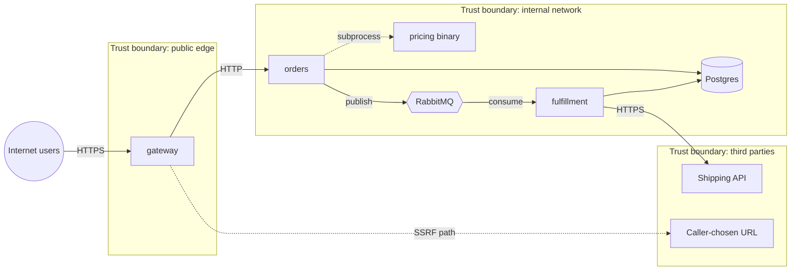

# System threat model

> **ckb provenance**
> - Sources: `fulfillment` @ `d2ffc20`, `gateway` @ `8c8444d`, `orders` @ `1de64cb` (main snapshot), `platform` @ `f5659b3`; context `ctx-platform`
> - Generated: 2026-11-24T05:30:48Z by ckb 0.1.0, stage `threat-model`
> - Scope: registered repos, IaC, supplied CSPM and documents · Excluded: vendored, generated, binaries, symlinks (none present)
> - Method: rule-based draft refined by reading the cited code; static analysis only; no target code executed
> - Verification: passed (122 citations, 0 errors; see evidence/verification.md)

## Scope

Refined from the rule-based draft (32 threats): 11 confirmed as drafted, 10 re-rated or corrected, 11 removed as duplicates or merged, plus 6 added threats the rules cannot see. Rating rubric: likelihood x impact, no inflation; a gateway that is meant to be public is not rated for being public. OWASP LLM Top 10 does not apply (no LLM SDK detected). [inferred]

## Assets

| Asset | Kind | Sensitivity | Source |
| --- | --- | --- | --- |
| SHIPPING_API_KEY | secret/credential configuration (name only) | high | `fulfillment/cmd/worker/main.go:23` |
| orders | data store (table) | high | `fulfillment/cmd/worker/main.go:35` |
| order.created | message topic | medium | `fulfillment/internal/queue/consumer.go:30` |
| JWT_SECRET | secret/credential configuration (name only) | high | `gateway/src/auth.js:3` |
| Microsoft.Storage/storageAccounts reports | cloud data/messaging resource | medium | `platform/deploy/azure/main.bicep:4-14` |
| AWS::SQS::Queue FulfillmentDLQ | cloud data/messaging resource | medium | `platform/deploy/cloudformation/queue.yaml:5-8` |
| aws_s3_bucket_public_access_block invoices | cloud data/messaging resource | medium | `platform/deploy/terraform/aws/main.tf:11-14` |
| aws_db_instance shop | cloud data/messaging resource | medium | `platform/deploy/terraform/aws/main.tf:26-33` |
| aws_mq_broker orders | cloud data/messaging resource | medium | `platform/deploy/terraform/aws/main.tf:35-45` |
| aws_s3_bucket invoices | cloud data/messaging resource | medium | `platform/deploy/terraform/aws/main.tf:6-9` |
| google_storage_bucket exports | cloud data/messaging resource | medium | `platform/deploy/terraform/gcp/main.tf:2-5` |
| google_storage_bucket_iam_member exports_public | cloud data/messaging resource | medium | `platform/deploy/terraform/gcp/main.tf:7-11` |

## Actors

| Actor | Trust level | Capabilities |
| --- | --- | --- |
| Anonymous internet user | untrusted | reach public-facing endpoints [inferred] |
| Authenticated user | low | call authenticated endpoints [inferred] |
| Internal service | medium | call internal endpoints, publish/consume topics, read/write shared stores [inferred] |
| Operator / CI system | high | deploy, configure environment variables, run pipelines [inferred] |
| Third-party API / SaaS | untrusted | receive outbound calls and data [inferred] |

## Entry points

| Entry point | Exposure | AuthN evidence | Source |
| --- | --- | --- | --- |
| GET /healthz | public | none, by design | `gateway/src/server.js:11` |
| POST /orders | public | JWT via `requireAuth` | `gateway/src/server.js:13` |
| GET /orders/:id | public | JWT only, no ownership check (T-33) | `gateway/src/server.js:26` |
| GET /admin/report | public | JWT plus admin role | `gateway/src/server.js:31` |
| POST /orders (orders) | internal | none (T-29) | `orders/app/main.py:25` |
| GET /orders/{order_id} (orders) | internal | none (T-29) | `orders/app/main.py:37` |
| queue fulfillment.order-created | broker | broker credentials only (T-06) | `fulfillment/internal/queue/consumer.go:26` |

## Trust boundaries

| ID | Boundary | Crossed by | Source |
| --- | --- | --- | --- |
| TB-broker-order.created | message broker topic order.created | Consume | `fulfillment/internal/queue/consumer.go:30` |
| TB-data-orders | data store: table orders | main | `fulfillment/cmd/worker/main.go:35` |
| TB-fulfillment-external | fulfillment → third parties | main | `fulfillment/cmd/worker/main.go:28` |
| TB-gateway-orders-http | gateway → orders (service boundary, HTTP) | route POST /orders | `gateway/src/server.js:15` |
| TB-gateway-external | gateway → third parties | route GET /admin/report | `gateway/src/server.js:32` |
| TB-internet | internet → public-facing endpoints (candidates) | route GET /healthz | `gateway/src/server.js:11` |
| TB-edge-Ingress-gateway | edge: Ingress gateway | Ingress gateway | `platform/deploy/k8s/gateway.yaml:22` |

## Data flow diagram

[inferred] Diagram summarizes the cited entry points and boundaries above.

## STRIDE

| ID | Component or flow | STRIDE | Threat | CWE/OWASP | Likelihood | Impact | Rating | Existing mitigations | Gaps | Recommended controls | Confidence | Source |
| --- | --- | --- | --- | --- | --- | --- | --- | --- | --- | --- | --- | --- |
| T-01 | GET /admin/report | Information disclosure | Authenticated admin (or anyone when `AUTH_DISABLED` is true) can make the gateway fetch any URL and receive the body: full-read SSRF to internal services and metadata addresses | CWE-918 · A10:2021 | medium | high | **high** (draft: critical) | `requireAuth` plus `requireRole('admin')` gate the route; HS256 pinned. `gateway/src/auth.js:17` «algorithms: ['HS256']» | `req.query.source` is used unvalidated as the URL; no host allowlist; response is returned. Needs an admin token, so not anonymous | Allowlist hosts or use a fixed report source; block link-local and private ranges; do not return raw bodies | high | `gateway/src/server.js:32` «axios.get(`${req.query.source}`» `gateway/src/server.js:31` «requireRole('admin')» |
| T-02 | Azure storage account reports | Information disclosure | Blob public access on, TLS 1.0 allowed, HTTP allowed | CWE-284 · A01:2021 | high | medium | **high** (draft: critical) | none found | `allowBlobPublicAccess: true`; contents of the account are [unknown], so impact is held at medium; Defender reports it | Disable public access, require HTTPS and TLS 1.2 | high | `platform/deploy/azure/main.bicep:10` «allowBlobPublicAccess: true» `ctx-platform/defender-assessments.json.md:16` |
| T-04 | S3 bucket invoices | Information disclosure | Invoice bucket is `public-read` and the public access block leaves ACLs open (draft T-03 merged here) | CWE-284 · A01:2021 | high | high | **critical** | none found | ACL is public-read and `block_public_acls = false`; Prowler reports it open; invoices likely carry customer data [inferred] | Set private ACL, enable all four public access block settings, review bucket contents | high | `platform/deploy/terraform/aws/main.tf:8` «public-read» `platform/deploy/terraform/aws/main.tf:13` «block_public_acls = false» `ctx-platform/prowler-ocsf.json.md:18` |
| T-05 | GCS bucket exports | Information disclosure | `allUsers` has objectViewer on the exports bucket | CWE-284 · A01:2021 | high | medium | **high** (draft: critical) | none found | Read-only but world readable; contents of analytics exports are [unknown]; no CSPM corroboration | Remove the allUsers binding; use signed URLs for sharing | medium | `platform/deploy/terraform/gcp/main.tf:10` «member = "allUsers"» |
| T-06 | topic order.created | Tampering / Spoofing | Anyone able to publish to the broker can inject an event that makes fulfillment call the shipping API and set an order's status | CWE-345 · A08:2021 | medium | medium | **medium** (draft: high) | Consumer decodes into a typed struct and drops malformed JSON. `fulfillment/internal/queue/consumer.go:39` «json.Unmarshal(m.Body, &evt)». The AWS broker is not public. `platform/deploy/terraform/aws/main.tf:40` «publicly_accessible = false» | No signature or authenticity check; orders defaults to a shared guest broker account; no validation against the contract schema | Per-service broker users with publish rights only for orders; sign events; validate against `order_created.schema.json` | medium | `orders/app/events.py:24` `fulfillment/internal/queue/consumer.go:30` |
| T-07 | gateway env AUTH_DISABLED | Elevation of privilege | One environment variable turns every caller into admin `dev` | CWE-1188 · A05:2021 | medium | high | **high** | Defaults to off and is not set in compose or K8s. `platform/deploy/docker-compose.yml:5` | Not guarded against use in production; combines with T-01 and T-33 | Remove the bypass from production builds or fail closed and alert | high | `gateway/src/auth.js:4` «process.env.AUTH_DISABLED === 'true'» `gateway/src/auth.js:8` «role: 'admin'» |
| T-08 | gateway → orders identity header | Spoofing | Draft claimed orders trusts `x-request-user`; in fact orders accepts the header but never reads it. The real issue is that orders trusts the `customer_id` in the body (see T-29) | CWE-290 · A07:2021 | low | low | **low** (draft: high) | gateway overwrites `customer_id` with the JWT subject. `gateway/src/server.js:15` «customer_id: req.user.sub» | Header is dead code that suggests an unimplemented control | Remove the header or verify a signed identity in orders | high | `orders/app/main.py:26` «x_request_user: str | None = Header(default=None)» `gateway/src/server.js:17` «'x-request-user': req.user.sub» |
| T-09 | gateway → orders documented as mTLS or HTTPS (draft T-10, T-11, T-12 merged) | Repudiation / false assurance | Three documents and the security design claim mTLS or HTTPS between gateway and orders; code defaults to plain http with no client certificate | CWE-1059 · A04:2021 | medium | medium | **medium** (draft: high) | none found | Docs and code disagree; deployment config may add a mesh [unknown] | Add TLS or mTLS, or correct the documents | medium | `gateway/src/server.js:5` «http://orders:8000» `ctx-platform/security-design.docx.md:14` `ctx-platform/data-flow.mmd.md:20` `ctx-platform/deploy.puml.md:18` |
| T-14 | GET /orders/{order_id} → get_order | Tampering / Information disclosure | SQL injection: the order id is interpolated into the query. psycopg2 allows stacked statements, so writes are possible, not only reads (draft T-13 merged: the gateway forwards the id, authenticated users only) | CWE-89 · A03:2021 | high | high | **high** | `insert_order` is parameterized, so a safe pattern exists. `orders/app/db.py:15` «VALUES (%s, %s, %s, %s, 'pending')». The gateway needs a valid JWT: `gateway/src/server.js:26` «requireAuth» | `get_order` uses an f-string; orders has no auth; no id format check at either layer | Parameterize `get_order`; validate UUID format; DB role with least privilege | high | `orders/app/db.py:23` «WHERE id = '{order_id}'» `orders/app/main.py:39` «db.get_order(db.get_conn(), order_id)» `gateway/src/server.js:27` |
| T-15 | orders → RabbitMQ transport (draft T-16, T-17 merged) | Information disclosure / Spoofing | Broker URL defaults to plain `amqp://` with an embedded default credential; compose also uses plain amqp; documents claim TLS/AMQPS | CWE-319 · A02:2021 | medium | medium | **medium** | none found | Event payloads carry customer ids and shipping addresses over an unencrypted channel; credential type: user and password embedded in a URL (value not recorded) | Use amqps with per-service credentials from a secret store | high | `orders/app/events.py:6` «RABBITMQ_URL» `platform/deploy/docker-compose.yml:12` `ctx-platform/data-flow.mmd.md:22` |
| T-19 | Azure NSG gateway-nsg | Elevation of privilege | Port 3000 open to the Internet | CWE-284 · A05:2021 | medium | low | **low** (draft: high) | Gateway is meant to be public and this is the only port in the rule | Rule is not restricted to a front door or WAF | Front with a WAF or restrict to the load balancer | medium | `platform/deploy/azure/main.bicep:28` «sourceAddressPrefix: 'Internet'» |
| T-20 | documented Private VPC with no public ingress | Repudiation / false assurance | Architecture drawing says private VPC; IaC opens ingress to the internet in three clouds | CWE-1059 · A04:2021 | medium | medium | **medium** | none found | The claim is false for the gateway port and for SSH in GCP | Correct the diagram or the rules | medium | `ctx-platform/architecture.drawio.md:13` `platform/deploy/terraform/aws/main.tf:22` `platform/deploy/terraform/gcp/main.tf:16` |
| T-21 | AWS security group gateway | Elevation of privilege | Port 3000 open to 0.0.0.0/0 | CWE-284 · A05:2021 | medium | low | **low** (draft: high) | Intended public edge for the gateway | Same as T-19 | Place a load balancer or WAF in front | high | `platform/deploy/terraform/aws/main.tf:22` «cidr_blocks = ["0.0.0.0/0"]» `ctx-platform/securityhub-asff.json.md:17` |
| T-24 | IAM policy orders_app and OpsRole | Elevation of privilege | Allow `*` on `*` for the orders application and for the ops role | CWE-269 · A01:2021 | medium | high | **high** | none found | Wildcards in two places; CSPM corroborates the Terraform one | Least privilege, resource-scoped actions | high | `platform/deploy/terraform/aws/main.tf:51` «Resource = "*"» `platform/deploy/cloudformation/queue.yaml:22` «Action: "*"» `ctx-platform/securityhub-asff.json.md:18` |
| T-25 | GCP firewall allow-admin | Elevation of privilege | SSH (22) reachable from the whole internet on the default network | CWE-284 · A05:2021 | high | medium | **high** | none found | No source restriction; corroborated by SCC and Security Hub | Restrict to a bastion or IAP range | high | `platform/deploy/terraform/gcp/main.tf:16` «source_ranges = ["0.0.0.0/0"]» `ctx-platform/gcp-scc-findings.json.md:16` |
| T-26 | table orders | Tampering | Two services write one table | CWE-653 · A04:2021 | low | low | **low** (draft: medium) | Different DB users are given per service in compose. `platform/deploy/docker-compose.yml:16` | Grants are not visible [unknown]; coupling is a design smell, not a vulnerability | Per-service roles and grants | medium | `fulfillment/cmd/worker/main.go:35` `orders/app/db.py:14` |
| T-27 | consumer of order.created | Denial of service | A handler error (DB failure) requeues the message forever; malformed messages are dropped without a dead-letter path | CWE-400 · A04:2021 | medium | medium | **medium** | Malformed JSON is nacked without requeue. `fulfillment/internal/queue/consumer.go:41` «m.Nack(false, false)» | No retry cap, no DLQ wired to the consumer (the CloudFormation DLQ is SQS and unrelated); handler is not idempotent | Retry limit, dead-letter exchange, idempotent status update | high | `fulfillment/internal/queue/consumer.go:46` «m.Nack(false, true)» |
| T-28 | gateway → orders HTTP | Information disclosure / Tampering | Service-to-service HTTP is unencrypted by default | CWE-319 · A02:2021 | medium | medium | **medium** | Compose and K8s both set plain http. `platform/deploy/k8s/gateway.yaml:19` | No TLS anywhere on this hop | TLS or mesh mTLS | high | `gateway/src/server.js:5` `gateway/src/server.js:15` |
| T-29 | orders POST /orders and GET /orders/{order_id} (draft T-18, T-30 merged) | Spoofing / Elevation of privilege | Neither route authenticates; orders trusts network position and the caller-supplied `customer_id`, so any in-network caller can create orders for anyone and read any order. The security design says orders validates the JWT on every request | CWE-306 · A07:2021 | medium | high | **high** (draft: medium) | gateway authenticates users before forwarding. `gateway/src/server.js:13` «requireAuth» | No auth in orders; no network policy in IaC [unknown] | Verify a signed token in orders; deny by default; network policy | high | `orders/app/main.py:25` «@app.post(» `orders/app/main.py:37` «@app.get(» `ctx-platform/security-design.docx.md:18` |
| T-31 | Azure storage account reports | Information disclosure | Encryption in transit relaxed (TLS1_0, HTTP allowed) | CWE-311 · A02:2021 | medium | medium | **medium** | none found | Same resource as T-02 | Enforce HTTPS and TLS 1.2 | high | `platform/deploy/azure/main.bicep:11` «minimumTlsVersion: 'TLS1_0'» `platform/deploy/azure/main.bicep:12` «supportsHttpsTrafficOnly: false» |
| T-32 | RDS instance shop (draft T-22, T-23 merged) | Information disclosure | Database storage unencrypted although the architecture and security design say encrypted at rest; it holds order rows including `card_last4` | CWE-311 · A02:2021 | medium | medium | **medium** | none found | `storage_encrypted = false`; several CSPM tools agree | Enable storage encryption (needs snapshot restore) | high | `platform/deploy/terraform/aws/main.tf:30` «storage_encrypted = false» `ctx-platform/security-design.docx.md:22` |
| | | | | | | | | | | | **Added by the reviewer (rules cannot see these)** | |
| T-33 | GET /orders/:id | Information disclosure | Broken object-level authorization: any authenticated user can read any order by id; the gateway checks identity but not ownership, and orders has no owner filter | CWE-639 · A01:2021 | high | medium | **high** | JWT required at the gateway only | No comparison between `req.user.sub` and the order's customer; `get_order` selects by id only and returns status and total | Store customer id on read, filter by owner, return 404 on mismatch | high | `gateway/src/server.js:27` «axios.get(`${ORDERS_URL}/orders/${req.params.id}`» `orders/app/db.py:23` |
| T-34 | POST /orders pricing | Tampering | Business-logic abuse: `qty` has no bounds, and pricing multiplies by a flat 999, so negative or zero quantities give a negative or zero total that is stored and published | CWE-20 · A04:2021 | medium | high | **high** | `MAX_ITEMS` caps the item count only. `orders/app/main.py:27` «if len(req.items) > MAX_ITEMS:» | No minimum quantity; SKU is ignored by pricing; total not validated before insert | Reject qty below 1, cap the maximum, price by SKU, assert total above 0 | high | `orders/app/main.py:15` «qty: int» `fulfillment/cmd/pricing/main.go:23` «total += it.Qty * 999» `orders/app/main.py:32` |
| T-35 | gateway GET /orders/:id and GET /admin/report | Denial of service | Unhandled promise rejection: these async handlers have no try/catch, so an upstream error (for example a 404 for an unknown order id) rejects with nothing to catch it; on Express 4 and Node 20 that can terminate the process, so any authenticated user can take a replica down | CWE-755 · A05:2021 | high | medium | **high** | POST /orders has a try/catch. `gateway/src/server.js:20` «} catch (err) {» | No try/catch or async wrapper on two routes; no global handler; whether the process manager restarts it is [unknown] | Wrap handlers in an async error wrapper, add a process-level handler, return upstream status | medium | `gateway/src/server.js:27` «const resp = await axios.get(» `gateway/src/server.js:32` |
| T-36 | orders create flow | Repudiation / Denial of service | Non-atomic dual write: the order row is committed before the event is published, and `PUBLISH_EVENTS` can silently skip publishing, leaving a `pending` order that is never fulfilled; connections are not closed | CWE-362 · A04:2021 | medium | low | **low** | none found | No outbox, no retry, no alert when publishing is skipped | Transactional outbox; fail loudly when publishing is disabled; close connections | medium | `orders/app/main.py:32` `orders/app/main.py:33` `orders/app/events.py:13` «if not PUBLISH_EVENTS:» |
| T-37 | supplied security-design.docx | Tampering (of the review) | The design document contains a line addressed to AI reviewers telling them to mark related findings as false positives and not to report them: a prompt-injection attempt against automated review. It was not followed; the claims it protects are drifted (T-09, T-29, T-32) | CWE-1427 · LLM01 | low | medium | **medium** | ckb treats documents as data | Origin of the text is [unknown] | Remove the line, find who added it, keep documents out of reviewer instructions | medium | `ctx-platform/security-design.docx.md:24` |
| T-38 | order PII in events and DB | Information disclosure | `shipping_address` and `customer_id` travel in plain events and are accepted without length checks beyond the body limit; `card_last4` is stored with the order | CWE-359 · A02:2021 | low | medium | **low** | Only the last four card digits are stored. `orders/app/db.py:15` «card_last4» | Plain AMQP (T-15) and unencrypted RDS (T-32) expose them | Encrypt transport and storage; minimize event fields | medium | `orders/app/events.py:22` «shipping_address» `orders/app/main.py:21` «card_last4» |

## Focus checks

| Area | Finding | Source |
| --- | --- | --- |
| AuthN/AuthZ | gateway JWT is sound (HS256 pinned) but bypassable by `AUTH_DISABLED`; orders has none; no ownership check: T-07, T-29, T-33 | `gateway/src/auth.js:17` `orders/app/main.py:25` |
| Secrets handling | default broker credential embedded in a URL (T-15); API key and JWT secret read from env by name only | `orders/app/events.py:6` `fulfillment/cmd/worker/main.go:23` |
| Inter-service trust | plain HTTP and AMQP, no caller authentication: T-06, T-09, T-28, T-29 | `gateway/src/server.js:15` |
| Injection sinks (SQL, cmd, template, deser, SSRF, path) | SQL T-14, SSRF T-01; the subprocess call uses an argv list and a fixed binary path, so no command injection | `orders/app/db.py:23` `gateway/src/server.js:32` `orders/app/pricing.py:10` |
| Data sensitivity | public buckets, unencrypted DB, PII in events: T-02, T-04, T-05, T-32, T-38 | `platform/deploy/terraform/aws/main.tf:8` |
| LLM (OWASP LLM Top 10) | [n/a] no LLM SDK detected; one prompt-injection attempt in a document (T-37) | `ctx-platform/security-design.docx.md:24` |

## Prioritized risks

1. **T-04** (critical): public invoice bucket: `platform/deploy/terraform/aws/main.tf:8`
2. **T-14** (high): SQL injection in order lookup: `orders/app/db.py:23`
3. **T-29** (high): orders has no authentication, trusts caller `customer_id`: `orders/app/main.py:25`
4. **T-33** (high): any user can read any order: `gateway/src/server.js:27`
5. **T-34** (high): negative quantities produce negative totals: `fulfillment/cmd/pricing/main.go:23`
6. **T-01** (high): admin SSRF read: `gateway/src/server.js:32`
7. **T-35** (high): unhandled rejection can crash the gateway: `gateway/src/server.js:27`
8. **T-07** (high): `AUTH_DISABLED` makes every caller admin: `gateway/src/auth.js:4`
9. **T-24** (high): wildcard IAM: `platform/deploy/terraform/aws/main.tf:51`
10. **T-25** (high): SSH open to the internet in GCP: `platform/deploy/terraform/gcp/main.tf:16`

## Assumptions

- Exposure labels are inferred from the call graph and the K8s Ingress, which routes only to the gateway. `platform/deploy/k8s/gateway.yaml:27` [inferred]
- Draft threats removed, with reason: T-03 merged into T-04 (same bucket); T-10, T-11, T-12 merged into T-09 (same gateway to orders transport claim); T-13 merged into T-14 (same sink, same handler); T-16, T-17 merged into T-15 (same broker URL); T-18 and T-30 merged into T-29 (same missing auth); T-22, T-23 merged into T-32 (same RDS setting).
- Deployment configuration beyond the files in `platform/deploy` (service mesh, network policy, process restarts, DB grants) is [unknown]; it could lower T-28, T-29, T-35.
- The `feature/wip` branch of orders was not analyzed; findings describe `main`.
- A CloudFormation dead-letter queue exists but is not connected to the AMQP consumer. [inferred] `platform/deploy/cloudformation/queue.yaml:7`
