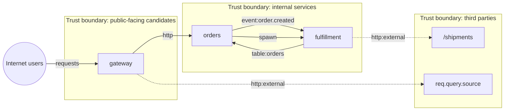

# System threat model (draft)

> **ckb provenance**
> - Sources: `fulfillment` @ `unversioned`, `gateway` @ `unversioned`, `orders` @ `unversioned`, `platform` @ `unversioned`
> - Generated: 2026-11-25T22:12:20Z by ckb threat_seed, stage `threat-model-draft`
> - Scope: registered repos, IaC, supplied CSPM/docs · Excluded: vendored, generated, binaries, symlinks
> - Method: deterministic rules over the knowledge graph; no target code executed; ratings per the ckb rubric
> - Verification: threats are mirrored as graph proposals (graph/proposals/seed-threats.jsonl) and verified by graph_merge

> **DRAFT** [inferred]: produced by rules, not by a reviewer. The threat-modeler agent confirms, refines, or removes each threat below; until then treat every item as a lead to check in the cited code. <!-- ckb:threat-seed -->

## Scope

Registered repos: `fulfillment`, `gateway`, `orders`, `platform`. Threats come from 36 rule hits. Rules cover injection paths, authentication evidence, security switches, service-to-service trust, messaging, shared state, timeouts, cloud posture, supply chain, documentation drift, and LLM use. [inferred]

## Assets

| Asset | Kind | Sensitivity | Source |
| --- | --- | --- | --- |
| SHIPPING_API_KEY | secret/credential configuration (name only) | high | `fulfillment/cmd/worker/main.go:23` |
| orders | data store (table) | high | `fulfillment/cmd/worker/main.go:35` |
| order.created | message topic | medium | `fulfillment/internal/queue/consumer.go:30` |
| JWT_SECRET | secret/credential configuration (name only) | high | `gateway/src/auth.js:3` |
| Microsoft.Storage/storageAccounts reports | cloud data/messaging resource | medium | `platform/azure/main.bicep:4-14` |
| AWS::SQS::Queue FulfillmentDLQ | cloud data/messaging resource | medium | `platform/cloudformation/queue.yaml:5-8` |
| aws_s3_bucket_public_access_block invoices | cloud data/messaging resource | medium | `platform/terraform/aws/main.tf:11-14` |
| aws_db_instance shop | cloud data/messaging resource | medium | `platform/terraform/aws/main.tf:26-33` |
| aws_mq_broker orders | cloud data/messaging resource | medium | `platform/terraform/aws/main.tf:35-45` |
| aws_s3_bucket invoices | cloud data/messaging resource | medium | `platform/terraform/aws/main.tf:6-9` |
| google_storage_bucket exports | cloud data/messaging resource | medium | `platform/terraform/gcp/main.tf:2-5` |
| google_storage_bucket_iam_member exports_public | cloud data/messaging resource | medium | `platform/terraform/gcp/main.tf:7-11` |

## Actors

| Actor | Trust level | Capabilities |
| --- | --- | --- |
| Anonymous internet user | untrusted | reach public-facing endpoints [inferred] |
| Authenticated user | low | call authenticated endpoints [inferred] |
| Internal service | medium | call internal endpoints, publish/consume topics, read/write shared stores [inferred] |
| Operator / CI system | high | deploy, configure environment variables, run pipelines [inferred] |
| Third-party API / SaaS | untrusted | receive outbound calls and data [inferred] |

## Entry points

| Entry point | Exposure | AuthN evidence | Source |
| --- | --- | --- | --- |
| GET /healthz | public | found or exempt | `gateway/src/server.js:11` |
| POST /orders | public | found or exempt | `gateway/src/server.js:13` |
| GET /orders/:id | public | found or exempt | `gateway/src/server.js:26` |
| GET /admin/report | public | found or exempt | `gateway/src/server.js:31` |
| POST /orders | internal | none found | `orders/app/main.py:25` |
| GET /orders/{order_id} | internal | none found | `orders/app/main.py:37` |

## Trust boundaries

| ID | Boundary | Crossed by | Source |
| --- | --- | --- | --- |
| TB-broker-order.created | message broker topic order.created | Consume | `fulfillment/internal/queue/consumer.go:30` |
| TB-data-orders | data store: table orders | main | `fulfillment/cmd/worker/main.go:35` |
| TB-fulfillment-external | fulfillment → third parties | main | `fulfillment/cmd/worker/main.go:28` |
| TB-gateway-orders-http | gateway → orders (service boundary, HTTP) | route POST /orders | `gateway/src/server.js:15` |
| TB-gateway-external | gateway → third parties | route GET /admin/report | `gateway/src/server.js:32` |
| TB-internet | internet → public-facing endpoints (candidates) | route GET /healthz | `gateway/src/server.js:11` |
| TB-edge-Ingress-gateway | edge: Ingress gateway | Ingress gateway | `platform/k8s/gateway.yaml:22` |

## Data flow diagram

## STRIDE

| ID | Component or flow | STRIDE | Threat | CWE/OWASP | Likelihood | Impact | Existing mitigations | Gaps | Recommended controls | Confidence | Source |
| --- | --- | --- | --- | --- | --- | --- | --- | --- | --- | --- | --- |
| T-01 [draft] | GET /admin/report → ssrf sink in route GET /admin/report | Information disclosure | SSRF injection path from GET /admin/report to an unsafe sink | CWE-918 · A10:2021 SSRF | high | high | A safe pattern exists elsewhere in gateway: 'gateway/src/server.js:27' (request input only in the URL path (check downstream handling)) | request input controls the URL/host; endpoint exposure: public (deployed as gateway (host-ports; platform/docker-compose.yml:2)). Taint is a candidate path: confirm the input reaches the sink. | Allowlist destination hosts; block link-local/metadata addresses; do not take URLs from requests. | high (observed) | `gateway/src/server.js:32` `gateway/src/server.js:31` |
| T-02 [draft] | Microsoft.Storage/storageAccounts reports | Information disclosure | Public cloud storage or service: Microsoft.Storage/storageAccounts reports | CWE-284 · A01:2021 Broken Access Control | high | high | none found | IaC declares it (SC-D07). A CSPM scan also reports it open (Microsoft Defender for Cloud): observed at scan time. | Block public access; require authenticated access | high (observed) | `platform/azure/main.bicep:10` `ctx-platform/defender-assessments.json.md:16` |
| T-03 [draft] | aws_s3_bucket_public_access_block invoices | Information disclosure | Public cloud storage or service: aws_s3_bucket_public_access_block invoices | CWE-284 · A01:2021 Broken Access Control | high | high | none found | IaC declares it (SC-D07). A CSPM scan also reports it open (Prowler (OCSF)): observed at scan time. | Block public access; require authenticated access | high (observed) | `platform/terraform/aws/main.tf:13` `ctx-platform/prowler-ocsf.json.md:18` |
| T-04 [draft] | aws_s3_bucket invoices | Information disclosure | Public cloud storage or service: aws_s3_bucket invoices | CWE-284 · A01:2021 Broken Access Control | high | high | none found | IaC declares it (SC-D07). A CSPM scan also reports it open (Prowler (OCSF)): observed at scan time. | Block public access; require authenticated access | high (observed) | `platform/terraform/aws/main.tf:8` `ctx-platform/prowler-ocsf.json.md:18` |
| T-05 [draft] | google_storage_bucket_iam_member exports_public | Information disclosure | Public cloud storage or service: google_storage_bucket_iam_member exports_public | CWE-284 · A01:2021 Broken Access Control | high | high | none found | IaC declares it (SC-D07). No CSPM result corroborates it. | Block public access; require authenticated access | medium (observed) | `platform/terraform/gcp/main.tf:10` |
| T-06 [draft] | topic order.created | Tampering / Spoofing | No integrity or authenticity check on messages from topic order.created | CWE-345 · A08:2021 Software and Data Integrity Failures | medium | high | none found | Neither side signs or validates payloads against a schema; anyone who can publish to the broker can trigger consumer actions. | Authenticate producers at the broker, sign or validate messages, and restrict publish permissions per service. | medium (inferred) | `orders/app/events.py:24` `fulfillment/internal/queue/consumer.go:30` |
| T-07 [draft] | gateway env AUTH_DISABLED | Elevation of privilege | Security control can be switched off by environment variable AUTH_DISABLED | CWE-1188 · A05:2021 Security Misconfiguration | medium | high | none found | 'const AUTH_DISABLED = process.env.AUTH_DISABLED === 'true';' toggles a protection; a mis-set variable in any environment disables it. Default: see the cited line. | Remove the bypass from production builds, or fail closed and alert when it is set outside local development. | high (observed) | `gateway/src/auth.js:4` |
| T-08 [draft] | gateway → orders (POST /orders) | Spoofing | orders may trust a caller-supplied identity header (x-request-user) | CWE-290 · A07:2021 Identification and Authentication Failures | medium | high | none found | The caller sets an identity header; unless the callee authenticates the caller (mTLS/signed token) and strips client-supplied copies at the edge, any in-network caller can impersonate a user. | Propagate a signed identity token (JWT/mTLS) and verify it in the callee; never trust plain headers. | medium (inferred) | `gateway/src/server.js:15` `orders/app/main.py:25` |
| T-09 [draft] | API Gateway (Express) → Orders service documented as mTLS RE | Repudiation / false assurance | Documented control not found in code or IaC: API Gateway (Express) → Orders service documented as mTLS REST | CWE-1059 · A04:2021 Insecure Design | medium | high | none found | API Gateway (Express) → Orders service documented as mTLS REST vs gateway calls orders with a plain-http default ('http://orders:8000'); no client certificate settings | Fix the code/IaC to match the claim, or correct the document; record the decision. | medium (inferred) | `gateway/src/server.js:5` `ctx-platform/architecture.drawio.md:24` |
| T-10 [draft] | API Gateway → Orders service documented as HTTPS | Repudiation / false assurance | Documented control not found in code or IaC: API Gateway → Orders service documented as HTTPS | CWE-1059 · A04:2021 Insecure Design | medium | high | none found | API Gateway → Orders service documented as HTTPS vs gateway calls orders with a plain-http default ('http://orders:8000'); no client certificate settings | Fix the code/IaC to match the claim, or correct the document; record the decision. | medium (inferred) | `gateway/src/server.js:5` `ctx-platform/data-flow.mmd.md:20` |
| T-11 [draft] | API Gateway → Orders service documented as HTTPS | Repudiation / false assurance | Documented control not found in code or IaC: API Gateway → Orders service documented as HTTPS | CWE-1059 · A04:2021 Insecure Design | medium | high | none found | API Gateway → Orders service documented as HTTPS vs gateway calls orders with a plain-http default ('http://orders:8000'); no client certificate settings | Fix the code/IaC to match the claim, or correct the document; record the decision. | medium (inferred) | `gateway/src/server.js:5` `ctx-platform/deploy.puml.md:18` |
| T-12 [draft] | All service-to-service traffic uses mutual TLS (mTLS) issued | Repudiation / false assurance | Documented control not found in code or IaC: All service-to-service traffic uses mutual TLS (mTLS) issued by the internal CA. | CWE-1059 · A04:2021 Insecure Design | medium | high | none found | All service-to-service traffic uses mutual TLS (mTLS) issued by the internal CA. vs gateway calls orders with a plain-http default ('http://orders:8000'); no client certificate settings | Fix the code/IaC to match the claim, or correct the document; record the decision. | medium (inferred) | `gateway/src/server.js:5` `ctx-platform/security-design.docx.md:14` |
| T-13 [draft] | orders workload orders | Elevation of privilege | Workload orders runs with elevated privileges (run_as_root) | CWE-250 · A05:2021 Security Misconfiguration | medium | high | none found | A compromise of the container gives the attacker the node or root inside the container. | Drop privileges, run as non-root, avoid host namespaces and hostPath mounts. | high (observed) | `orders/Dockerfile:1` |
| T-14 [draft] | GET /orders/:id → sql sink in get_order | Tampering / Information disclosure | SQL injection path from GET /orders/:id to an unsafe sink | CWE-89 · A03:2021 Injection | medium | high | A safe pattern exists elsewhere in orders: 'orders/app/db.py:14' (parameterized) | string-built query; endpoint exposure: public (deployed as gateway (host-ports; platform/docker-compose.yml:2)). Taint is a candidate path: confirm the input reaches the sink. | Use parameterized queries / ORM bindings; validate id formats. | medium (inferred) | `orders/app/db.py:23` `gateway/src/server.js:26` `gateway/src/server.js:27` |
| T-15 [draft] | GET /orders/{order_id} → sql sink in get_order | Tampering / Information disclosure | SQL injection path from GET /orders/{order_id} to an unsafe sink | CWE-89 · A03:2021 Injection | medium | high | A safe pattern exists elsewhere in orders: 'orders/app/db.py:14' (parameterized) | string-built query; endpoint exposure: internal (deployed as orders with no public Service/Ingress (orders/Dockerfile:1)). Taint is a candidate path: confirm the input reaches the sink. | Use parameterized queries / ORM bindings; validate id formats. | high (observed) | `orders/app/db.py:23` `orders/app/main.py:37` `orders/app/main.py:39` |
| T-16 [draft] | 'RabbitMQ (TLS)' is documented as TLS-protected | Repudiation / false assurance | Documented control not found in code or IaC: 'RabbitMQ (TLS)' is documented as TLS-protected | CWE-1059 · A04:2021 Insecure Design | medium | high | none found | 'RabbitMQ (TLS)' is documented as TLS-protected vs broker URL default uses plain 'amqp://' (no TLS) in orders | Fix the code/IaC to match the claim, or correct the document; record the decision. | medium (inferred) | `orders/app/events.py:6` `ctx-platform/architecture.drawio.md:18` |
| T-17 [draft] | Orders service → RabbitMQ (TLS) documented as AMQPS order.cr | Repudiation / false assurance | Documented control not found in code or IaC: Orders service → RabbitMQ (TLS) documented as AMQPS order.created | CWE-1059 · A04:2021 Insecure Design | medium | high | none found | Orders service → RabbitMQ (TLS) documented as AMQPS order.created vs broker URL default uses plain 'amqp://' (no TLS) in orders | Fix the code/IaC to match the claim, or correct the document; record the decision. | medium (inferred) | `orders/app/events.py:6` `ctx-platform/architecture.drawio.md:25` |
| T-18 [draft] | Orders service → RabbitMQ documented as AMQPS | Repudiation / false assurance | Documented control not found in code or IaC: Orders service → RabbitMQ documented as AMQPS | CWE-1059 · A04:2021 Insecure Design | medium | high | none found | Orders service → RabbitMQ documented as AMQPS vs broker URL default uses plain 'amqp://' (no TLS) in orders | Fix the code/IaC to match the claim, or correct the document; record the decision. | medium (inferred) | `orders/app/events.py:6` `ctx-platform/data-flow.mmd.md:22` |
| T-19 [draft] | The orders service validates the caller JWT on every request | Repudiation / false assurance | Documented control not found in code or IaC: The orders service validates the caller JWT on every request before reading or w | CWE-1059 · A04:2021 Insecure Design | medium | high | none found | The orders service validates the caller JWT on every request before reading or writing orders. vs 2 of 2 endpoint(s) in orders show no authentication evidence (e.g. POST /orders) | Fix the code/IaC to match the claim, or correct the document; record the decision. | medium (inferred) | `orders/app/main.py:25` `ctx-platform/security-design.docx.md:18` |
| T-20 [draft] | Microsoft.Network/networkSecurityGroups nsg | Elevation of privilege | Ingress open to the internet: Microsoft.Network/networkSecurityGroups nsg | CWE-284 · A05:2021 Security Misconfiguration | high | medium | none found | IaC declares it (SC-D05). No CSPM result corroborates it. | Restrict ingress to required sources; put services behind a gateway/WAF | medium (observed) | `platform/azure/main.bicep:28` |
| T-21 [draft] | 'Private VPC (no public ingress)' is documented as private / | Repudiation / false assurance | Documented control not found in code or IaC: 'Private VPC (no public ingress)' is documented as private / no public ingress ( | CWE-1059 · A04:2021 Insecure Design | medium | high | none found | 'Private VPC (no public ingress)' is documented as private / no public ingress (contains: API Gateway (Express), Orders service, Fulfillment worker, RabbitMQ (TLS), Postgres shop (encrypted)) vs 3 ingress rule(s) open to the internet in IaC… | Fix the code/IaC to match the claim, or correct the document; record the decision. | medium (inferred) | `platform/azure/main.bicep:28` `ctx-platform/architecture.drawio.md:13` |
| T-22 [draft] | aws_security_group gateway | Elevation of privilege | Ingress open to the internet: aws_security_group gateway | CWE-284 · A05:2021 Security Misconfiguration | high | medium | none found | IaC declares it (SC-D05). A CSPM scan also reports it open (AWS Security Hub (ASFF)): observed at scan time. | Restrict ingress to required sources; put services behind a gateway/WAF | high (observed) | `platform/terraform/aws/main.tf:22` `ctx-platform/securityhub-asff.json.md:17` |
| T-23 [draft] | 'Postgres shop (encrypted)' is documented as encrypted | Repudiation / false assurance | Documented control not found in code or IaC: 'Postgres shop (encrypted)' is documented as encrypted | CWE-1059 · A04:2021 Insecure Design | medium | high | none found | 'Postgres shop (encrypted)' is documented as encrypted vs IaC disables encryption/TLS for aws_db_instance shop: 'storage_encrypted = false' | Fix the code/IaC to match the claim, or correct the document; record the decision. | medium (inferred) | `platform/terraform/aws/main.tf:30` `ctx-platform/architecture.drawio.md:19` |
| T-24 [draft] | The database is encrypted at rest. | Repudiation / false assurance | Documented control not found in code or IaC: The database is encrypted at rest. | CWE-1059 · A04:2021 Insecure Design | medium | high | none found | The database is encrypted at rest. vs IaC disables encryption/TLS for aws_db_instance shop: 'storage_encrypted = false' | Fix the code/IaC to match the claim, or correct the document; record the decision. | medium (inferred) | `platform/terraform/aws/main.tf:30` `ctx-platform/security-design.docx.md:22` |
| T-25 [draft] | aws_iam_policy orders_app | Elevation of privilege | Wildcard IAM permissions: aws_iam_policy orders_app | CWE-269 · A01:2021 Broken Access Control | medium | high | none found | IaC declares it (SC-D08). A CSPM scan also reports it open (AWS Security Hub (ASFF), CSV export): observed at scan time. | Replace wildcard actions with least-privilege, resource-scoped permissions | high (observed) | `platform/terraform/aws/main.tf:51` `ctx-platform/securityhub-asff.json.md:18` `ctx-platform/wiz-issues.csv.md:17` |
| T-26 [draft] | google_compute_firewall admin | Elevation of privilege | Ingress open to the internet: google_compute_firewall admin | CWE-284 · A05:2021 Security Misconfiguration | high | medium | none found | IaC declares it (SC-D05). A CSPM scan also reports it open (AWS Security Hub (ASFF), CSV export, GCP Security Command Center): observed at scan time. | Restrict ingress to required sources; put services behind a gateway/WAF | high (observed) | `platform/terraform/gcp/main.tf:16` `ctx-platform/gcp-scc-findings.json.md:16` `ctx-platform/securityhub-asff.json.md:18` |
| T-27 [draft] | table orders | Tampering | Table orders is written by several services (fulfillment, orders) | CWE-653 · A04:2021 Insecure Design | medium | medium | none found | Shared writers couple services to one schema and make it hard to enforce per-service invariants and least privilege. | Give each table one owning service, or enforce per-service DB roles and constraints. | medium (inferred) | `fulfillment/cmd/worker/main.go:35` `orders/app/db.py:14` |
| T-28 [draft] | consumer of order.created | Denial of service | Failed messages are requeued without a dead-letter path (order.created) | CWE-400 · A04:2021 Insecure Design | medium | medium | none found | A poison message is retried forever and may repeat side effects (duplicates). No dead-letter configuration found. | Add a retry limit and dead-letter queue; make handlers idempotent. | high (observed) | `fulfillment/internal/queue/consumer.go:46` |
| T-29 [draft] | gateway → orders (service-to-service HTTP) | Information disclosure / Tampering | Plain HTTP between gateway and orders | CWE-319 · A02:2021 Cryptographic Failures | medium | medium | none found | The default destination is 'http://orders:8000' (no TLS). Deployment config may override it; none was found in scope. | Use TLS (ideally mTLS via a service mesh) for service-to-service traffic. | medium (observed) | `gateway/src/server.js:5` `gateway/src/server.js:15` |
| T-30 [draft] | orders dynamic dispatch | Tampering | Dynamic dispatch at app/db.py:14 (exec) is invisible to the call graph | CWE-470 · A03:2021 Injection | low | medium | none found | A path that goes through reflection, eval or a dynamic lookup cannot be followed statically; review whether attacker-influenced data picks the target. | Replace dynamic lookup with an allowlist of targets; validate names against it. | low (inferred) | `orders/app/db.py:14` |
| T-31 [draft] | orders dynamic dispatch | Tampering | Dynamic dispatch at app/db.py:23 (exec) is invisible to the call graph | CWE-470 · A03:2021 Injection | low | medium | none found | A path that goes through reflection, eval or a dynamic lookup cannot be followed statically; review whether attacker-influenced data picks the target. | Replace dynamic lookup with an allowlist of targets; validate names against it. | low (inferred) | `orders/app/db.py:23` |
| T-32 [draft] | POST /orders | Spoofing / Elevation of privilege | No authentication evidence on POST /orders | CWE-306 · A07:2021 Identification and Authentication Failures | medium | medium | none found | No auth middleware, decorator, or role check found on the route or its handler chain (exposure: internal: deployed as orders with no public Service/Ingress (orders/Dockerfile:1)). Global middleware or gateway-level auth would not be seen here. | Authenticate and authorize in the service itself (do not rely on network position); deny by default. | medium (inferred) | `orders/app/main.py:25` |
| T-33 [draft] | GET /orders/{order_id} | Spoofing / Elevation of privilege | No authentication evidence on GET /orders/{order_id} | CWE-306 · A07:2021 Identification and Authentication Failures | medium | medium | none found | No auth middleware, decorator, or role check found on the route or its handler chain (exposure: internal: deployed as orders with no public Service/Ingress (orders/Dockerfile:1)). Global middleware or gateway-level auth would not be seen here. | Authenticate and authorize in the service itself (do not rely on network position); deny by default. | medium (inferred) | `orders/app/main.py:37` |
| T-34 [draft] | Microsoft.Storage/storageAccounts reports | Information disclosure | Encryption or TLS disabled: Microsoft.Storage/storageAccounts reports | CWE-311 · A02:2021 Cryptographic Failures | medium | medium | none found | IaC declares it (SC-D09). A CSPM scan also reports it open (Microsoft Defender for Cloud): observed at scan time. | Enable encryption at rest and require TLS 1.2+ | high (observed) | `platform/azure/main.bicep:11` `ctx-platform/defender-assessments.json.md:16` |
| T-35 [draft] | platform workload gateway | Lateral movement / Information disclosure | No NetworkPolicy restricts traffic to or from gateway | CWE-284 · A05:2021 Security Misconfiguration | medium | medium | none found | No NetworkPolicy was found in this repo; the cluster may apply a default-deny elsewhere. | Add default-deny ingress/egress and allow only the required peers. | low (inferred) | `platform/k8s/gateway.yaml:2` |
| T-36 [draft] | aws_db_instance shop | Information disclosure | Encryption or TLS disabled: aws_db_instance shop | CWE-311 · A02:2021 Cryptographic Failures | medium | medium | none found | IaC declares it (SC-D09). A CSPM scan also reports it open (GCP Security Command Center, Microsoft Defender for Cloud, Prowler (OCSF)): observed at scan time. | Enable encryption at rest and require TLS 1.2+ | high (observed) | `platform/terraform/aws/main.tf:30` `ctx-platform/defender-assessments.json.md:16` `ctx-platform/gcp-scc-findings.json.md:16` |

## Focus checks

| Area | Finding | Source |
| --- | --- | --- |
| AuthN/AuthZ | 2 draft threat(s): T-32, T-33 | `orders/app/main.py:25` `orders/app/main.py:37` |
| Secrets handling | none detected by the rules [inferred] | [n/a] |
| Inter-service trust | 1 draft threat(s): T-08 | `gateway/src/server.js:15` |
| Injection sinks (SQL, cmd, template, deser, SSRF, path) | 3 draft threat(s): T-01, T-14, T-15 | `gateway/src/server.js:32` `orders/app/db.py:23` |
| Data sensitivity | 8 draft threat(s): T-02, T-03, T-04, T-05, T-20, T-22 | `platform/azure/main.bicep:10` `platform/terraform/aws/main.tf:13` |
| LLM (OWASP LLM Top 10) | no LLM SDK detected | [n/a] |

## Attack paths

Entry point to sink over every resolved edge kind (calls, class and object calls, references, library calls, agent dispatch, FFI, HTTP, queues, spawns). Exposure comes from deployment facts when present; a control in front of the entry point lowers the rank; coverage is the resolved-call percentage of the repos crossed. Paths are candidates, not proven dataflow. [inferred]

| # | Entry point | Exposure | Control in front | Path | Via | Sink | Evidence | Repos | Coverage | Source |
| --- | --- | --- | --- | --- | --- | --- | --- | --- | --- | --- |
| 1 | GET /orders/:id | public | - | GET /orders/:id → route GET /orders/:id → GET /orders/{order_id} → read_order → get_order → sql sink in get_order | calls, http_calls, reaches_sink, routes_to | sql (CWE-89) | inferred | gateway, orders | 20.8% | `orders/app/db.py:23` |
| 2 | GET /admin/report | public | - | GET /admin/report → route GET /admin/report → ssrf sink in route GET /admin/report | reaches_sink, routes_to | ssrf (CWE-918) | observed-path | gateway | 20.8% | `gateway/src/server.js:32` |
| 3 | GET /orders/{order_id} | internal | - | GET /orders/{order_id} → read_order → get_order → sql sink in get_order | calls, reaches_sink, routes_to | sql (CWE-89) | observed-path | orders | 62.9% | `orders/app/db.py:23` |

## Analysis coverage and blind spots

| Repo | Calls resolved or library | Entry points | Functions no entry point reaches | Dynamic-dispatch hotspots | Dormant unsafe sinks |
| --- | --- | --- | --- | --- | --- |
| fulfillment | 58.8% | 1 | 2 | 0 | 0 |
| gateway | 20.8% | 4 | 0 | 0 | 0 |
| orders | 62.9% | 2 | 0 | 2 | 0 |
| platform | [n/a] | 0 | 0 | 0 | 0 |

Low coverage lowers confidence in every path above; see `system/coverage.md` for the unresolved names and hotspots. Static analysis cannot prove that every path was found. [inferred]

## Prioritized risks

1. **T-01** (critical): SSRF injection path from GET /admin/report to an unsafe sink: `gateway/src/server.js:32`
2. **T-02** (critical): Public cloud storage or service: Microsoft.Storage/storageAccounts reports: `platform/azure/main.bicep:10`
3. **T-03** (critical): Public cloud storage or service: aws_s3_bucket_public_access_block invoices: `platform/terraform/aws/main.tf:13`
4. **T-04** (critical): Public cloud storage or service: aws_s3_bucket invoices: `platform/terraform/aws/main.tf:8`
5. **T-05** (critical): Public cloud storage or service: google_storage_bucket_iam_member exports_public: `platform/terraform/gcp/main.tf:10`
6. **T-06** (high): No integrity or authenticity check on messages from topic order.created: `fulfillment/internal/queue/consumer.go:30`
7. **T-07** (high): Security control can be switched off by environment variable AUTH_DISABLED: `gateway/src/auth.js:4`
8. **T-08** (high): orders may trust a caller-supplied identity header (x-request-user): `gateway/src/server.js:15`
9. **T-09** (high): Documented control not found in code or IaC: API Gateway (Express) → Orders service documented as mTLS REST: `gateway/src/server.js:5`
10. **T-10** (high): Documented control not found in code or IaC: API Gateway → Orders service documented as HTTPS: `gateway/src/server.js:5`

## Assumptions

- Exposure labels are inferred from the call graph (an endpoint nobody else calls is a public candidate); confirm against ingress/gateway configuration. [inferred]
- Authentication evidence is looked for on the route line and handler chain only: global middleware and gateway-level auth are not visible to these rules. [inferred]
- Taint paths are candidate reachability over call/route edges, not a full data-flow proof. [inferred]
