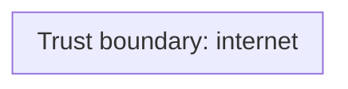

# {{scope_name}}: threat model

> **ckb provenance**
> - Sources: {{sources_with_revisions}}
> - Generated: {{iso8601}} by ckb {{version}}, stage `{{stage}}`
> - Scope: {{scope}} · Excluded: {{exclusions}}
> - Method: static analysis only; no target code executed
> - Verification: {{verification_status}}

## Scope
## Assets
| Asset | Sensitivity | Where stored or processed | Source |
| --- | --- | --- | --- |
## Actors
| Actor | Trust level | Capabilities |
| --- | --- | --- |
## Entry points
| Entry point | Exposure (internet/internal/admin) | AuthN | Source |
| --- | --- | --- | --- |
## Trust boundaries
| ID | Boundary | Crossed by | Source |
| --- | --- | --- | --- |

## Data flow diagram

## STRIDE
| ID | Component or flow | STRIDE | Threat | CWE/OWASP | Likelihood | Impact | Existing mitigations (cited) | Gaps | Recommended controls | Confidence |
| --- | --- | --- | --- | --- | --- | --- | --- | --- | --- | --- |

## Focus checks
| Area | Finding | Source |
| --- | --- | --- |
| AuthN/AuthZ | | |
| Secrets handling | | |
| Inter-service trust | | |
| Injection sinks (SQL, cmd, template, deser, SSRF, path) | | |
| Data sensitivity | | |
| LLM (OWASP LLM Top 10), if applicable | | |

## Assumptions
<!-- speculative threats without code evidence go here, not in the STRIDE table -->

## Prioritized risks
