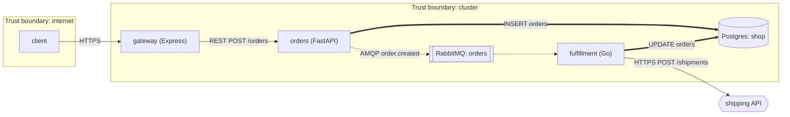

# Mermaid rules for ckb outputs

Adapted from OthmanAdi/codebase-knowledge-builder (MIT).

1. **Synthetic IDs:** `S_gateway`, `S_orders`, `DB_shop`, `Q_orders`, `X_shipping`. Never use repo-supplied identifiers as IDs.
2. **Labels you write:** `S_orders["orders (FastAPI)"]`. Keep them under ~40 characters, double-quoted, with no `"` inside (use `'`), and no backticks, `<`, `>`, or `|` from target text.
3. **No interactivity:** no `click`, `call`, `href`, or HTML labels.
4. **Trust boundaries** use `subgraph TB_internet["Trust boundary: internet"] ... end`.
5. **Edge labels** name the mechanism: `S_gateway -->|"REST POST /orders"| S_orders`, `S_orders -.->|"AMQP order.created"| S_fulfillment`. Solid for sync, dotted for async, thick (`==>`) for shared state.
6. **Shapes:** services `[" "]`, datastores `[(" ")]`, queues `[[" "]]`, externals `{{" "}}`.
7. **Sequence diagrams:** participants are aliases (`participant GW as gateway`). Put error paths in `alt`/`else` blocks.
8. **Size:** split diagrams with more than about 25 nodes by domain or flow.

Example:

